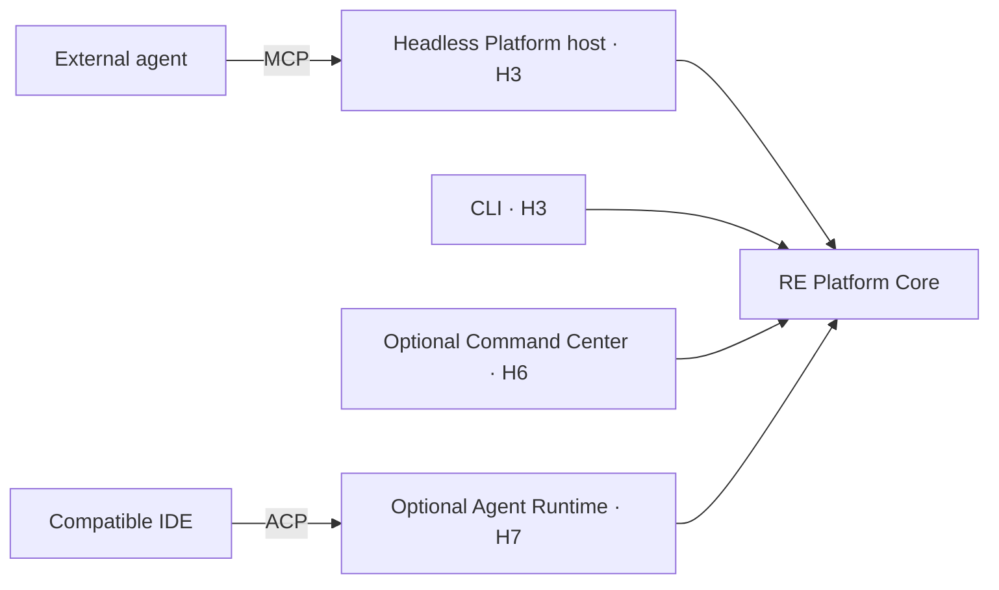

# RE_Ecosystem

### Evidence-driven reverse engineering and software analysis

RE_Ecosystem is a research and engineering project developing a platform for structured binary analysis, with deterministic tools providing the evidence and AI agents helping researchers investigate it.

The project addresses a practical problem: reverse-engineering workflows span multiple analyzers, reports, scripts and agent conversations. Results can be difficult to compare, preserve and verify. RE_Ecosystem aims to make the investigation—not the chat session—the durable unit of work, with traceable artifacts, explicit analysis outcomes and findings that can be checked against their sources.

**Current stage:** developer prototype with an implemented deterministic triage baseline; the broader platform is under development. **Progress snapshot:** 14 October 2026.

## What exists today

The repository contains a C#/.NET implementation, a Windows desktop interface, Python analysis components and local persistence. The PRE-H0 deterministic triage baseline is recorded as **DONE in project tracking**; the capabilities below are supported by the current source.

| Area | Implemented foundation | Source |
|---|---|---|
| Deterministic triage | `ITriagePipeline → TriageService`; native/.NET analysis and direct subprocess execution, without an LLM or MCP in the canonical triage path | [Pipeline](RE.Core/Abstractions/ITriagePipeline.cs), [service](RE.Core/Services/TriageService.cs) |
| Binary inspection | File hashes, metadata, PE section/entropy/import signals, Windows signature checks, and Detect It Easy/Binwalk adapter paths | [Analysis implementation](RE.Core/StaticAnalysis/), [Python analyzer](mcp_server/triage_analyzer.py) |
| Android inspection | APK/container and manifest analysis, including Android metadata and permission signals | [Python analyzer](mcp_server/triage_analyzer.py) |
| Results and reporting | Structured triage results, analyzer errors, pipeline recommendations and Markdown reports | [Result model](RE.Domain/Models/TriageResult.cs), [report generator](mcp_server/report_generator.py) |
| Desktop workflow | WinUI triage interface consuming the pipeline and saving triage history | [Triage ViewModel](RE.WinUI/ViewModels/TriageViewModel.cs) |
| Local persistence | SQLite-backed project, chat and triage history | [KnowledgeStore](RE.Infrastructure/Persistence/KnowledgeStore.cs) |
| Regression coverage | Tests for deterministic execution, cancellation, subprocess/native failures, malformed inputs, large files and report sanitization | [C# tests](App_Test/DeterministicTriageTests.cs), [Python tests](mcp_server/test_triage.py) |

Available analysis depends on the selected native libraries, Python dependencies and input format. A triage score is a heuristic signal for investigation, not a verified malware verdict.

On 14 October 2026, the publication snapshot passed **85 .NET tests (67 PRE-H0 regressions plus 18 publication-safety cases), 56 Python regression probes and four isolated UI checks**. A clean candidate with bootstrapped dependencies also built successfully. These results are scoped to Windows x64 and are not full platform acceptance or measured productivity gains; see [validation evidence](docs/VALIDATION_PRE_H0.md) and the [implementation snapshot](docs/CURRENT_STATE.md).

Current publication safeguards include per-user settings with DPAPI-protected credential references and a fail-closed allowlist for reviewed read-only MCP calls. Active and unknown tools are blocked; scope-bound approval and the full H2/H8 policy services remain planned. Existing Antigravity private-provider bridge code is experimental and is not required for deterministic triage.

## Research workflow

The existing baseline supports the first stage of a larger investigation:

1. **Inspect an artifact.** Calculate hashes and collect structural, signature and platform-specific signals using deterministic analyzers.
2. **Record the outcome.** Preserve structured results, errors and reports so incomplete analysis remains visible.
3. **Investigate evidence — planned.** Link artifacts, runs and findings through canonical records; give an agent relevant evidence rather than an unrestricted dump of tool output.
4. **Verify conclusions — planned.** Check important findings against source evidence and retain a clear distinction between observations, hypotheses and verified results.

The research objective is to reduce repetitive analysis work while preserving the analyst's ability to reproduce and challenge a conclusion.

## Architecture

RE_Ecosystem has two product blocks: **RE Platform** and **RE Command Center**. The platform contains a Core, protocol adapters and an optional Agent Runtime.

| Component | Responsibility | Delivery status |
|---|---|---|
| **RE Platform Core / RE Core** | Canonical state, persistence, Evidence/Finding, capability/policy, verification, bounded evidence context/cache and RE adapters | Existing implementation slices; full platform contracts and services are planned |
| **RE Agent Runtime = AI Harness** | Planner, agent loop, model routing, skill/goal execution, agent memory, budgets and subagents | Optional H7 milestone |
| **RE Command Center** | Windows/WinUI control plane for manual workflows, reports and optional agent interaction | Existing desktop prototype; full H6 control plane is planned |

The **logical Platform Core is broader than the C# project named `RE.Core`**. Domain, Application, Infrastructure and adapter projects contribute to it. Migration proceeds within the existing solution.

The target consumer paths are:



These are **TARGET interfaces**, not a claim of completed interoperability. External agents will use their own harness to access Core services; they will not need our Agent Runtime or GUI. The target Core must also operate without an LLM, MCP transport or GUI. The current deterministic triage lane already follows the direct-analysis boundary.

## Development roadmap

| Milestone | Planned delivery |
|---|---|
| **PRE-H0 — DONE in project tracking** | Deterministic triage baseline and regression coverage |
| **H0** | Canonical Project/Case/Artifact/Run/Evidence/Finding state, lifecycle and persistence |
| **H1** | Evidence-linked deterministic findings, scorecard, verifier and SARIF |
| **H2** | Core capability registry, backend policy/approval and bounded evidence context |
| **H3** | Independently launchable Platform host, CLI and MCP projection |
| **H4–H5** | Portable workflow skills, verified host configurations and deeper RE adapters |
| **H6** | Optional Command Center over Core state; supplied external-session links |
| **H7** | Optional Agent Runtime/AI Harness and ACP integration |
| **H8–H9** | Governed active analysis, reproducible evaluation and justified federation/scale |

The next implementation priority is **H0: durable investigation state**, followed by evidence-linked analysis and headless access. H0–H6 do not require our H7 Runtime. Completion depends on the acceptance gates in [STRATEGY.md](STRATEGY.md), rather than on the presence of a diagram or integration stub.

## Research collaboration and Antigravity evaluation

For the [Google Antigravity scientific-workflow interest program](https://docs.google.com/forms/d/e/1FAIpQLScSnOMSFSm8zfM9siaXufuqAeR6ZP6R33DTzxjqJObjW61GzQ/viewform), the proposed contribution is an applied **software-analysis and security-engineering research workflow**.

RE_Ecosystem offers a concrete deterministic baseline from which to investigate how an agent can select analysis steps, retrieve relevant evidence, generate checkable hypotheses and produce reports an analyst can audit. The proposed evaluation would use public or synthetic artifacts with documented provenance and compare a manual workflow, deterministic tooling and agent-assisted investigation.

| Research question | Proposed evaluation |
|---|---|
| Can an agent produce conclusions that are supported by the analysis? | Check evidence references and independently verify findings against a documented corpus |
| Does bounded evidence retrieval improve the workflow? | Compare context size, token usage, repeated tool calls and task completion |
| Does assistance save analyst effort? | Measure time to a verified finding and the corrections needed during review |
| Does the workflow handle incomplete evidence responsibly? | Exercise malformed inputs, unavailable analyzers, timeouts and cancellation |

These are **planned experiments**, not measured outcomes. Antigravity interoperability is a proposed evaluation target. Existing provider/bridge experiments are not a supported production integration; future integration should use documented, supported interfaces.

The desired collaboration is feedback on agent/tool boundaries, evaluation design and reproducible research artifacts.

## Engineering principles

- **Evidence before conclusions.** Important findings need provenance and explicit verification; completing a run does not verify its findings.
- **Failure remains visible.** Missing evidence, analyzer errors and unknown results must not become a “safe” conclusion.
- **Policy belongs in the backend.** The target Core applies the same controls to GUI, CLI, external agents and our optional Runtime; side effects require explicit approval.
- **Tool output is untrusted data.** Binary strings, decompiler comments and network payloads cannot grant instructions or permissions.
- **AI is optional.** No local LLM, GPU or GNN is required for the deterministic baseline or the target essential Core services.
- **Claims are scoped.** CURRENT, TARGET, EXPERIMENTAL and HISTORICAL are distinct; metrics must be labelled MEASURED, SLO/TARGET or HYPOTHESIS.

## Explore and develop

The current solution uses **C#/.NET 10**, **WinUI 3 / Windows App SDK**, **Python**, **SQLite** and native analysis adapters. Desktop development requires Windows and the appropriate toolchain. See [Prerequisites](Prerequisites.md) before building; analysis components also require their native/Python dependencies.

The published native payload and Python lock are for **Windows x64**. Bootstrap downloads hash-checked CPython 3.11.9, exact wheel versions and a pinned DIE signature database without rebuilding Qt/native libraries. Only reviewed deployment files are included; [artifact hashes and provenance](lib/artifacts.json) and [third-party notices](lib/notices/README.md) distinguish measured hashes from supplied native source refs.

After configuring those prerequisites, the repository entry points are:

```powershell
git clone https://github.com/tiendungdo12/RE_Ecosystem.git
cd RE_Ecosystem
pwsh -NoProfile -File scripts/Setup-Runtime.ps1
dotnet restore RE_Ecosystem.slnx
dotnet build RE.WinUI/RE.WinUI.csproj -p:Platform=x64 -r win-x64
```

Regression checks: `dotnet test App_Test/App_Test.csproj` and `.\Python_Runtime\python.exe mcp_server/test_triage.py`. Optional UI verification: `pwsh -NoProfile -File scripts/Verify-Publication-UI.ps1`; it launches a local instance with isolated synthetic data.

Settings are stored under `%LOCALAPPDATA%/RE_Ecosystem/Settings/`; API keys are DPAPI-protected files referenced by metadata. Legacy project/chat/triage history remains in the ignored root `knowledge.db`. The explicit developer variable `RE_ECOSYSTEM_USER_DATA_ROOT` redirects settings and the legacy database to an isolated directory without relocating normal user data.

The existing Python subprocess runner can be exercised separately:

```powershell
.\Python_Runtime\python.exe .\mcp_server\direct_triage.py "C:\path\to\sample.exe"
```

That command runs the Python analysis component and emits JSON with a Markdown report; it does not replace the complete C# pipeline or constitute the planned H3 Platform CLI.

| Documentation | Purpose |
|---|---|
| [Documentation Index](docs/DOCUMENTATION_INDEX.md) | Canonical sources and repository inventory |
| [Current State](docs/CURRENT_STATE.md) | Implemented source and remaining gaps |
| [Architecture](docs/ARCHITECTURE.md) / [Domain Model](docs/DOMAIN_MODEL.md) | Component ownership and target investigation contracts |
| [Strategy](STRATEGY.md) | Milestones, dependencies and acceptance gates |
| [Security](docs/SECURITY.md) / [Interoperability](docs/INTEROPERABILITY.md) | Backend policy and supported integration boundaries |

The repository also includes eight RE engineering skills and forty milestone role prompts for implementation, independent review, fixes and re-review. These support disciplined delivery; they are distinct from the portable end-user workflow packages planned at H4.
