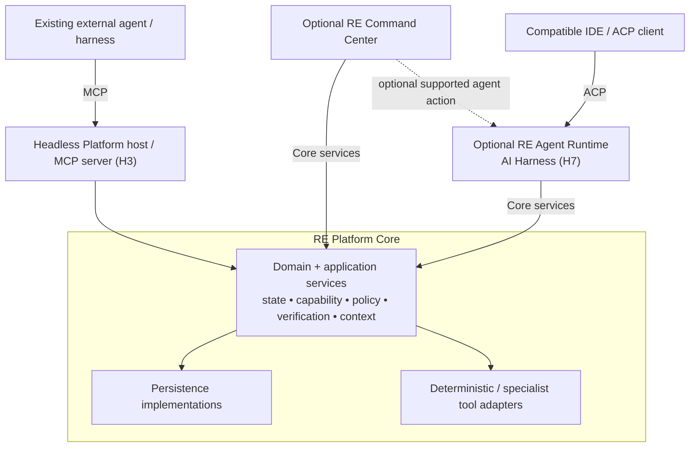

# RE_Ecosystem Architecture

> **Status:** Canonical TARGET, clarified 13 October 2026. [CURRENT_STATE](CURRENT_STATE.md) records source facts. [Architecture source chain](ARCHITECTURE_RESET.md#architecture-source-chain) explains the approved terminology correction.

## Two products, three logical components

| Component | Owns | Independence |
|---|---|---|
| **RE Platform Core / RE Core** | Domain/state, persistence, Evidence/Finding, Capability/Policy, Verification, Context/Cache, deterministic RE and tool adapters | Works without LLM, AI Harness, MCP transport or GUI |
| **RE Agent Runtime = AI Harness** | Planner, agent loop, model routing, skill/goal execution, subagents, retries and agent memory/context | Optional H7 component consuming Core services |
| **RE Command Center** | WinUI control plane for projects/cases/artifacts/runs/evidence/findings/reports, policies and available agent/session views | Optional client consuming Core, optionally requesting agent actions |

**RE Platform = Core + protocol adapters + optional Agent Runtime.** Command Center is the other product block. A plain Core use case can execute analysis, persist a Run and Evidence, create Findings and verify them without an agent.

External agents use their own agent loop. They do not pass through our H7 Runtime to call Core. H3's independently launchable Platform host composes Core and protocol adapters, not an AI Harness. The SDK/MCP application notion of “host” is also distinct from this server-side Platform process.

## Logical Core vs projects

Logical Platform Core is not identical to the current assembly `RE.Core`. Preserve the existing solution during migration:

| Project | Target role |
|---|---|
| `RE.Domain` | Platform domain types/invariants; no UI, SQLite, protocol SDK or model types |
| `RE.Core` | Existing RE analysis library/contracts; current mixed responsibilities are transitional |
| `RE.Application` | Platform Core use cases, state orchestration, policy/capability/context ports and logic |
| `RE.Infrastructure` | Platform persistence and concrete adapters; separate existing AI/provider code from required Core composition |
| `RE.Platform.Windows` | Windows-specific platform adapters behind portable contracts |
| `RE.Presentation`, `RE.WinUI`, `RE.SecondUI` | Optional presentation/client projects |
| `RE.AgentRuntime` | Proposed H7 runtime component name; no such complete project is claimed CURRENT |

Dependency direction remains inward: Core application services depend on Domain contracts; Infrastructure implements application ports and is wired by executable composition roots. Domain/application do not depend on concrete Infrastructure. Persistence is a Core capability implemented through those ports, not in pure domain classes. Windows/native adapters do not introduce GUI/agent requirements. Do not create `RE.Harness` at H0 to house state/policy. The suggested `src/` tree is not a mandated immediate code move.

## Context and state ownership

Core owns canonical Project/Case/Artifact/Run/Evidence/Finding state and backend policy. Runtime/external-agent conversation memory, planning state and model selection are separate consumer concerns. A Core Run can describe deterministic execution; it is not necessarily an agent loop.

Core ContextBroker/EvidenceResolver resolves evidence handles, applies disclosure policy, truncates/slices responses and manages evidence/context cache. Runtime manages its model conversation and step/token/time budgets, using Core context services; those services do not require a model.

## Command Center and external sessions

H6 presents Core state and supplied external-session metadata. [ExternalSessionLink](DOMAIN_MODEL.md#external-session-links-target-h6) links a host/agent session to a Case without making that session canonical. Transcripts, summaries, status and artifacts are available only when the host/user provides them through supported interfaces. A link does not grant control or import/verified-finding authority. H9 may add deeper federation.

Command Center can request an optional own-agent action at H7 or a supported external-agent action. UI remains a client; it need not contain the planner/model SDK/agent loop.

## Modes and acceptance

- **Core library:** application use cases + storage/adapters, no agent, UI or MCP transport.
- **Headless Platform host:** CLI/MCP server exposing the same Core services; independently launched or client-started.
- **Command Center:** optional human/manual and deterministic workflows over Core.
- **Agent Runtime:** optional separate/embedded host component with ACP at H7; deployment choice does not change its architectural boundary.
- **Remote/federated:** later deployment with explicit security/compatibility gates.

Acceptance must show persisted analysis/Evidence/Finding/verification without LLM, Runtime, MCP transport or GUI; an H3 client accessing Core with Runtime and WinUI absent; H6 GUI seeing the same state and working without Runtime; and H7 removal/disablement leaving Core state and external-agent access intact. These are future implementation gates, not runtime results already demonstrated.
