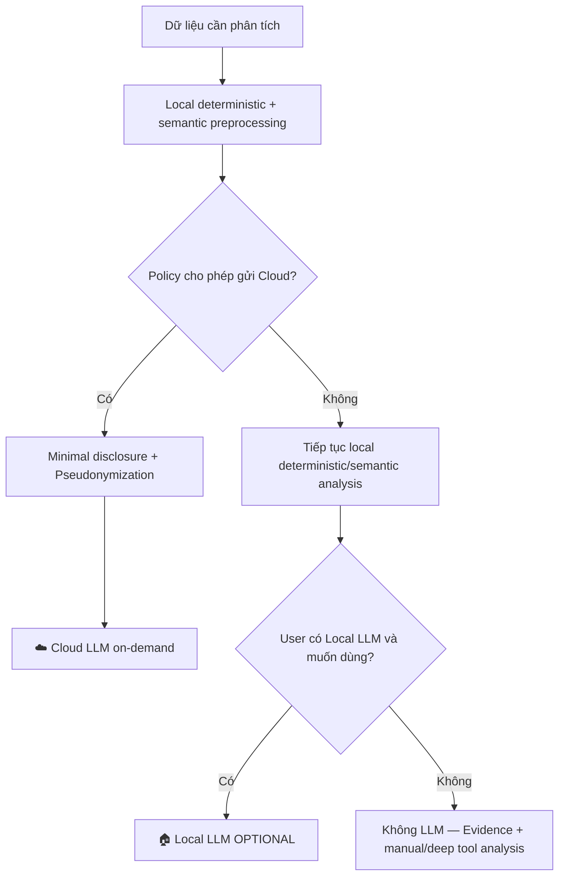
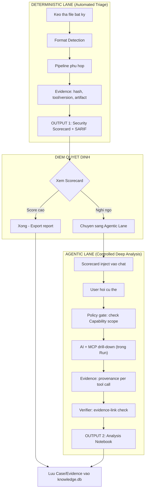

> [!CAUTION]
> **HISTORICAL / RESEARCH — terminology clarification, 13 October 2026.** Earlier Harness/platform ownership and implementation/metric claims below are preserved research, not current contracts. [Canonical architecture](docs/ARCHITECTURE.md) assigns state/policy/evidence/persistence to RE Platform Core and reserves AI Harness for optional H7 RE Agent Runtime. The [following architecture conversation](docs/reference/ARCHITECTURE_TERMINOLOGY_CLARIFICATION.md) clarifies the source vision. Use [CURRENT](docs/CURRENT_STATE.md) for actual source status.

---
# Nghiên Cứu Chiến Lược: RE CommandCenter 2.0 — RE-Native Agent Harness (UX "JetBrains cho RE")

> **Ngày:** 27/08/2026 (Cập nhật: 20/09/2026)  
> **Bối cảnh:** Phân tích sau buổi đề xuất hệ thống quản lý K8s/Jenkins/Server tập trung, đối chiếu với dự án
> RE_Ecosystem hiện tại  
> **Mục tiêu:** Xác định hướng đi rõ ràng: xây **RE-native agent harness** có kiểm soát và kiểm chứng được; dùng trải
> nghiệm "JetBrains cho RE" làm cách định vị sản phẩm; phân tích cạnh tranh 2026.
> **Trạng thái:** **RESEARCH / DESIGN NOTEBOOK** — dùng để lưu nghiên cứu và rationale. Trạng thái triển khai thực tế
> phải xem `STRATEGY.md` và source code; không coi mọi sơ đồ trong file này là đã implement.

---

## Mục Lục

1. [Chẩn Đoán Vấn Đề Gốc Rễ & Tầm Nhìn "JetBrains cho RE"](#1-chẩn-đoán-vấn-đề-gốc-rễ)
2. [Phân Tích Cạnh Tranh — Landscape RE 2026](#15-phân-tích-cạnh-tranh--landscape-re-2026)
3. [Vấn đề 1: Nền Tảng Tập Trung — Cái Khó Là Quy Trình](#2-vấn-đề-1-nền-tảng-tập-trung--cái-khó-là-quy-trình)
4. [Vấn đề 2: AI Cloud — Bảo Mật, Token & Context Window](#3-vấn-đề-2-ai-cloud--bảo-mật-token--context-window)
5. [Vấn đề 3: Phân Tích Toolchain — Có Cần Bằng Đó Tool?](#4-vấn-đề-3-phân-tích-toolchain--có-cần-bằng-đó-tool)
6. [Vấn đề 4: Workflow Hai Giai Đoạn & Hiện Trạng Hỗ Trợ File](#5-vấn-đề-4-workflow-hai-giai-đoạn--hiện-trạng-hỗ-trợ-file)
7. [WinUI App & Phân Tích Osaurus Windows](#6-winui-app--dư-thừa-hay-không)
8. [Quyết Định Kiến Trúc: RE-Native Agent Harness](#66-quyết-định-kiến-trúc-re-native-agent-harness-cập-nhật-13092026)
9. [Đề Xuất Hướng Đi Chiến Lược](#7-đề-xuất-hướng-đi-chiến-lược)
10. [Kết Luận](#8-kết-luận)

---

## 1. Chẩn Đoán Vấn Đề Gốc Rễ & Tầm Nhìn "JetBrains Cho RE"

Sau khi đối chiếu codebase với hướng kiến trúc mới, vấn đề gốc không còn là “thiếu tool” mà là **độ lệch giữa workbench
hiện tại và harness mục tiêu**. Project separation/Clean Architecture đã có nền tảng, native wrappers cho DIE/Binwalk là
lợi thế tốt, nhưng boundary giữa `RE.Core`/`RE.Application`/`RE.Infrastructure`, persistence và AI provider còn cần hội
tụ. **Cần phân biệt rõ 3 thứ:**

```
┌─────────────────────────────────────────────────────────┐
│                    BẠN ĐANG XÂY DỰNG                     │
│                                                         │
│  ① TOOLBOX (Hộp công cụ)                                │
│     → Tập hợp nhiều tool RE vào 1 nơi                   │
│     → Đã làm rất tốt: DIE, Binwalk, LIEF, IDA, Burp    │
│                                                         │
│  ② PLATFORM (Nền tảng)                                  │
│     → Quy trình, workflow, data flow giữa các tool      │
│     → Đang thiếu: chưa có workflow engine rõ ràng       │
│                                                         │
│  ③ PRODUCT (Sản phẩm)                                   │
│     → Output cụ thể mà người dùng cuối nhận được        │
│     → Đang mơ hồ: "Báo cáo toàn diện" là gì chính xác?│
└─────────────────────────────────────────────────────────┘
```

> [!IMPORTANT]
> **Kết luận sớm:** App WinUI của bạn **KHÔNG dư thừa** về mặt kỹ thuật — nó là nền tảng cần thiết. Câu trả lời cho "sản
phẩm cuối cùng là gì?" = **RE-native agent harness**: mỗi file phân tích tạo ra một `Case` → `Run` → `Evidence`-linked
Scorecard. Deterministic lane (0 AI token) xuất Scorecard có provenance; agentic lane (AI chat) hoạt động trong scope
`Capability` + `Policy`, có `Verifier` kiểm chất lượng.

### 1.1 ✨ BỔ SUNG: Tầm Nhìn "JetBrains Cho Reverse Engineering"

Sau khi nghiên cứu landscape RE tools/agents 2026, **RE Ecosystem đang nhắm vào một tổ hợp nhu cầu chưa thấy có một sản
phẩm Windows-native trưởng thành bao phủ trọn vẹn**. Không nên diễn đạt tuyệt đối là “chưa ai làm”, vì đã có Rikugan,
re-mcp, ghidra-rpc và nhiều agentic RE project giải quyết từng phần:

```
                    PHÂN LOẠI THỊ TRƯỜNG RE 2026

 ┌──────────────────────────────────────────────────────────┐
 │   "ALL-IN-ONE" BINARY ANALYSIS (Static Analysis IDE)    │
 │   IDA Pro / Binary Ninja / Ghidra / JEB / Cutter        │
 │   → Rất mạnh về disassembly + decompile + plugin        │
 │   → NHƯNG: không có dynamic, memory, network, triage    │
 └──────────────────────────┬───────────────────────────────┘
                            │
     ┌──────────────────────┼──────────────────────┐
     │                      │                      │
 ┌───┴────────────┐  ┌──────┴──────────┐  ┌───────┴────────┐
 │  DYNAMIC TOOLS │  │  NETWORK TOOLS  │  │  MEMORY TOOLS  │
 │  x64dbg, Frida │  │  Burp, mitmproxy│  │  MemProcFS     │
 │  WinDbg, GDB   │  │  Wireshark      │  │  KsDumper      │
 └────────────────┘  └─────────────────┘  └────────────────┘

      KHOẢNG TRỐNG RE COMMANDCENTER NHẮM TỚI:
 ┌─────────────────────────────────────────────────────────┐
 │   RE-Native Agent Harness (UX "JetBrains cho RE")      │
 │   RE Ecosystem / RE CommandCenter 2.0                   │
 │   → Unified frontend cho TẤT CẢ layers trên            │
 │   → Deterministic lane (triage) + Agentic lane (deep)  │
 │   → Multi-format: PE + APK + ELF trong 1 app           │
 │   → Harness: Evidence + Policy + Capability + Verifier  │
 └─────────────────────────────────────────────────────────┘
```

> [!TIP]
> **Analogies chính xác:** Nếu IDA Pro ≈ IntelliJ (1 ngôn ngữ, rất sâu), thì RE Ecosystem nhắm vào ≈ **JetBrains Fleet /
VS Code** (orchestrator đa ngôn ngữ, kết nối nhiều engine backend, AI-first). Tuy nhiên, khác với VS Code, RE Ecosystem
có thêm tầng **Agent Harness** (`Policy` + `Evidence` + `Verifier`) để kiểm soát an toàn mọi tương tác AI trên binary —
VS Code không có cơ chế này.

---

## 1.5 Phân Tích Cạnh Tranh — Landscape RE 2026

### 1.5.1 Bản Đồ Đối Thủ Theo Tầng

| Tầng                               | Ai đang làm?                                                                      | Cách tiếp cận                                                                    | RE Ecosystem khác gì?                                                                                                                                                                                              |
|:-----------------------------------|:----------------------------------------------------------------------------------|:---------------------------------------------------------------------------------|:-------------------------------------------------------------------------------------------------------------------------------------------------------------------------------------------------------------------|
| **Binary Analysis IDE**            | IDA Pro, Binary Ninja, Ghidra, JEB, Cutter/Rizin                                  | Disassembler + decompiler + plugin. Mỗi cái là 1 "IDE đóng" cho static analysis  | RE Ecosystem **không tự viết disassembler** — dùng IDA/Ghidra làm backend qua MCP, focus vào orchestration layer phía trên                                                                                         |
| **AI Binary Intelligence (Cloud)** | RevEng.AI (BinNet, \$15M NATO Series A)                                           | Cloud platform, binary embedding vectors, IDA/Ghidra plugin cắm thêm             | RE Ecosystem là **desktop-first, local-first**, không phải cloud SaaS. Bổ sung chứ không thay thế                                                                                                                  |
| **AI Agent Layer (MCP)**           | ReVa (cyberkaida), re-mcp (jtsylve), ghidra-headless-mcp (mrphrazer), reverser_ai | Viết MCP server để LLM điều khiển IDA/Ghidra headlessly                          | RE Ecosystem **tự viết 3 domain MCP servers** (học hỏi nguyên lí từ re-mcp) cho Phase 2 chat, tách biệt hoàn toàn với deterministic triage chạy bằng Direct Calls. Thêm: scorecard, UI dashboard, pseudonymization |
| **AI-assisted RE Features**        | Binary Ninja Sidekick 26, IDA 9 Hex-Rays AI, Ghidra + Claude plugins              | Agentic sub-agents bên trong 1 disassembler (rename, transform, research, debug) | RE Ecosystem wrap NHIỀU disassemblers + tools khác (memory, network, game engine) vào 1 frontend. Sidekick chỉ hoạt động trong Binary Ninja                                                                        |
| **Mobile Security Scanner**        | MobSF, QARK, APKLeaks                                                             | Automated SAST/DAST cho APK, output là vulnerability list                        | RE Ecosystem đi sâu hơn: triage → scorecard → manual deep analysis chat. Không chỉ scan tự động                                                                                                                    |
| **Desktop Agent Harness**          | Osaurus (macOS→Windows)                                                           | General-purpose AI agent, không biết gì về RE                                    | RE Ecosystem là **domain-specific** cho RE, không phải general agent                                                                                                                                               |

### 1.5.2 Phân Tích 4 Đối Thủ Gần Nhất

#### ① Binary Ninja + Sidekick 26 — Đối thủ gần nhất

| Tiêu chí               | Binary Ninja Sidekick 26                                                        | RE Ecosystem                                                              |
|:-----------------------|:--------------------------------------------------------------------------------|:--------------------------------------------------------------------------|
| **Triết lý**           | "RE IDE" — 1 app chứa tất cả binary analysis                                    | "RE Orchestrator" — 1 app kết nối tất cả tools                            |
| **Decompiler**         | ✅ Tự viết (BNIL: LLIL→MLIL→HLIL), cực mạnh                                     | ❌ Dùng Ghidra/IDA/JADX backend qua MCP                                   |
| **AI**                 | ✅ Sidekick 26: multi-agent (Research, Transform, Repair, Debugger, Automation) | ✅ Hybrid: Deterministic triage (0 token) + AI chat deep analysis         |
| **Multi-format**       | ✅ PE, ELF, Mach-O (native), nhưng **yếu Android APK/DEX**                      | ✅ PE + APK + ELF. APK là first-class citizen (AXML, packer detect, JADX) |
| **Dynamic analysis**   | ⚠️ Có debugger built-in nhưng **không có memory dump, network intercept**       | ✅ MemProcFS, KsDumper, Burp Suite, Frida, eCapture                       |
| **Kernel/Ring 0**      | ❌ Không                                                                        | ✅ MemProcFS + KsDumper (P/Invoke)                                        |
| **Game engine**        | ❌ Không hiểu Unity/Flutter/Cocos                                               | ✅ Il2CppDumper, Blutter, engine-aware routing                            |
| **Security Scorecard** | ❌ Không có concept này                                                         | ✅ 7 Pillars + MASVS/SDL mapping                                          |
| **Giá**                | \$299-2,499/năm (thương mại)                                                    | Tự build (có thể miễn phí hoặc internal tool)                             |
| **Platform**           | Windows + macOS + Linux                                                         | Windows (WinUI 3)                                                         |

> [!IMPORTANT]
> **Nhận định:** Binary Ninja Sidekick là đối thủ mạnh nhất về **"AI + binary analysis trong 1 app"**. Nhưng nó thiếu
**orchestration đa tầng** (memory, network, game engine, triage pipeline, scorecard) — đây chính là differentiation của
RE Ecosystem. RE Ecosystem không cạnh tranh trực tiếp với Binary Ninja — nó **bao bọc** Binary Ninja/IDA/Ghidra làm
backend engine.

---

#### ② RevEng.AI (BinNet) — Tầng khác, bổ sung chứ không thay thế

| Tiêu chí      | RevEng.AI                                                                 | RE Ecosystem                                     |
|:--------------|:--------------------------------------------------------------------------|:-------------------------------------------------|
| **Mô hình**   | Cloud SaaS / On-prem API                                                  | Desktop-first app                                |
| **Core tech** | Binary embedding AI (BinNet) — vector search across billions of functions | Deterministic triage + rule engine + AI chat     |
| **Use case**  | Software supply chain verification, malware attribution, auto-unstrip     | Hands-on RE workflow: triage → analysis → report |
| **Giá**       | Enterprise SaaS (giấu giá)                                                | Self-built                                       |

> [!NOTE]
> RevEng.AI và RE Ecosystem **không cạnh tranh**. RevEng.AI là "lớp AI phủ lên trên IDA/Ghidra" — nó add AI features vào
tool cũ. RE Ecosystem là "frontend mới gom tất cả tools lại". Về lý thuyết, RE Ecosystem có thể **tích hợp RevEng.AI
API** như 1 tool nữa trong pipeline.

---

#### ③ RE MCP Servers (ReVa, re-mcp, ghidra-headless-mcp, reverser_ai)

| MCP Server                          | Engine       | Điểm mạnh                                                                             | RE Ecosystem tận dụng?                                                                                             |
|:------------------------------------|:-------------|:--------------------------------------------------------------------------------------|:-------------------------------------------------------------------------------------------------------------------|
| **ReVa** (cyberkaida)               | Ghidra       | Giảm context rot bằng micro-tools + contextual nudges                                 | ⚠️ Tham khảo ý tưởng giảm context rot; backend Ghidra gom vào MCP-RE-Deep tự viết                                  |
| **re-mcp** (jtsylve)                | IDA + Ghidra | Unified interface — cùng 1 API dùng cho cả IDA và Ghidra, headless, supervisor/worker | ✅ **Rất phù hợp về nguyên lí** — tham khảo pattern unified interface để tự viết MCP-RE-Deep, không dùng trực tiếp |
| **ghidra-headless-mcp** (mrphrazer) | Ghidra       | Container/CI/CD automation, no GUI                                                    | ✅ Tốt cho batch processing Phase 3                                                                                |
| **reverser_ai** (mrphrazer)         | Binary Ninja | Local LLM cho auto-rename functions                                                   | ⚠️ Tham khảo, nhưng RE Ecosystem dùng cloud AI + pseudonymization                                                  |

> [!TIP]
> **Chiến lược MCP:** **Tự viết MCP-RE-Deep** dựa trên nguyên lí từ `re-mcp` (unified interface, batch execution,
progressive discovery), nhưng code mới hoàn toàn — token-first design, chỉ expose 5-8 compound tools. Burp/Frida MCP
cũng viết mới (thin wrappers, 2-3 compound tools mỗi cái). Triage pipeline gọi trực tiếp P/Invoke, không cần MCP.

---

#### ④ SEMA-GUARD — giữ semantic representation; GNN là optional ranker, không phải Local LLM requirement

SEMA-GUARD (Dursunoglu & Sulkalar, 15/09/2026) enrich CFG bằng **stack manipulation, memory access, simplified
taint/data-flow và indirect control-flow semantics**, rồi dùng GNN để vulnerability classification ở **function-level**.
Paper báo cáo Accuracy 85,1%, Precision 0,860, Recall 0,774 và F1 0,801 trên dataset xây từ Juliet.

Điểm quan trọng đối với RE CommandCenter:

> **SEMA-GUARD không đồng nghĩa phải chạy Local LLM.** GNN là một loại ML chuyên dữ liệu graph, nhỏ và hẹp hơn LLM rất
> nhiều. PyTorch/PyG có thể inference trên CPU. Tuy nhiên, vì mục tiêu của RE CommandCenter là giảm cấu hình máy và
> dependency, **GNN không được trở thành requirement của core**.

Tách framework thành hai lớp:

```text
Semantic layer (không ML)
  assembly normalization
  + CFG
  + stack behavior
  + memory behavior
  + simplified taint/data-flow
  + indirect control flow
        ↓
  SemanticFunctionProfile

Optional ML layer
  SemanticFunctionProfile + graph
        ↓
  GNN
        ↓
  VulnerabilityCandidate
```

### Quyết định sản phẩm

**Core nên giữ/phát triển semantic layer.** Nó giúp:

- tạo Evidence có ngữ nghĩa hơn imports/entropy đơn thuần;
- xếp hạng function bằng rule-based logic không ML;
- nén context trước khi gửi cloud model;
- hỗ trợ IDA/Ghidra deep analysis;
- làm input cho GNN/model tương lai mà không đổi harness contract.

**GNN của SEMA-GUARD chỉ giữ như optional research/plugin.**

Lý do không dùng nó làm gate:

- Recall paper chỉ 0,774;
- confusion matrix có **2.407 vulnerable functions bị dự đoán safe**;
- paper nhận xét false negatives thường xuất hiện khi risky behavior trải qua nhiều instructions hoặc indirect control
  transfer;
- dataset hiện là Juliet-derived và authors nêu cần đánh giá thêm trên real-world firmware/binaries.

Do đó:

```text
GNN says suspicious -> tăng priority
GNN says safe       -> KHÔNG skip analysis
```

### Hướng triển khai phù hợp phần cứng thấp

```text
RE CommandCenter Core
   ├── Deterministic triage          CPU / 0 AI
   ├── SemanticFeatureExtractor      CPU / 0 AI
   ├── RuleBasedSemanticRanker       CPU / 0 AI
   ├── Pseudonymization              CPU / 0 AI
   ├── Cloud LLM                     OPTIONAL, on-demand
   ├── SemaGuardGnnRanker            OPTIONAL local ML
   └── Local LLM / Ollama            OPTIONAL deployment
```

Privacy model vì vậy **không ép user chạy Local LLM**. Với dữ liệu được phép đưa cloud, app có thể:
`local deterministic + semantic preprocessing → minimal disclosure → pseudonymization → cloud reasoning`.
Nếu policy không cho cloud, deterministic/semantic analysis vẫn dùng được đầy đủ; user có thể bật Local LLM nếu họ có
hardware/phù hợp yêu cầu.

### Fork hay reimplement?

- Giữ upstream clone/fork để reproduce paper và làm baseline.
- Không vendor nó vào Harness Core.
- Sở hữu interface `ISemanticFeatureExtractor`, `ISemanticRiskRanker`, `SemanticFunctionProfile`,
  `VulnerabilityCandidate`.
- Implement `RuleBasedSemanticRanker` trước.
- Chỉ đóng gói `SemaGuardGnnRanker` nếu CPU benchmark cho thấy lợi ích thực tế.
- Nếu GNN không đáng dependency/latency, bỏ plugin nhưng giữ semantic layer.
- Trước khi redistribute/copy source, kiểm tra software license trực tiếp trong repo; license của paper không tự động là
  license của code.

Nguồn:

- Paper: https://arxiv.org/abs/2609.17254
- Code reference: https://github.com/dursunoglu/SEMAGUARD

### 1.5.3 Gap Analysis: RE Ecosystem Đã Đủ Thành "JetBrains Cho RE" Chưa?

```
  "JetBrains cho RE" cần gì?          RE Ecosystem có chưa?

  ┌─────────────────────────────┐
  │ ① Unified Project Workspace │   ⚠️ Chưa — hiện chỉ có single-file triage
  │    (multi-binary, sessions) │       Cần: Project concept, session history
  ├─────────────────────────────┤
  │ ② Multi-Engine Backend      │   ⚠️ Kế hoạch Phase 2 — IDA/Ghidra/JADX qua MCP-RE-Deep tự viết
  │    (IDA, Ghidra, JADX)      │       Cần: Tự viết MCP-RE-Deep với unified interface (học từ re-mcp)
  ├─────────────────────────────┤
  │ ③ Deterministic Triage      │   ✅ Có (85%) — DIE/Binwalk/LIEF/Hash/Authenticode
  │    Pipeline                 │       Cần: Scorecard output formatting
  ├─────────────────────────────┤
  │ ④ AI Deep Analysis Chat     │   ✅ Có — dual-provider, function calling, streaming
  │                             │       Cần: Pseudonymization, compound tools
  ├─────────────────────────────┤
  │ ⑤ Security Scoring          │   ⚠️ Thiết kế xong (7 Pillars) nhưng chưa implement
  │    (Scorecard, SARIF)       │       Cần: Map findings → CWE/ATT&CK → score
  ├─────────────────────────────┤
  │ ⑥ Dynamic Analysis          │   ⚠️ Kế hoạch Phase 2-3: Frida, MemProcFS, KsDumper
  │    (Debug, Memory, Hook)    │       Cần: Implement integrations
  ├─────────────────────────────┤
  │ ⑦ Network Analysis          │   ⚠️ Kế hoạch Phase 2: Burp Suite MCP
  │    (Intercept, PCAP)        │       Cần: Implement Burp MCP client
  ├─────────────────────────────┤
  │ ⑧ Game Engine Awareness     │   ⚠️ Routing rules có, tools chưa integrate
  │    (Unity, Flutter, Cocos)  │       Cần: Il2CppDumper, Blutter integration
  ├─────────────────────────────┤
  │ ⑨ Multi-Format Support      │   ✅ Có — PE/APK/ELF/DEX/Firmware detection
  │    (PE, APK, ELF, firmware) │       Cần: Hoàn thiện ELF checksec, APK signing
  ├─────────────────────────────┤
  │ ⑩ Dashboard & Reporting     │   ✅ Có — WinUI Fluent Design, card/badge
  │                             │       Cần: Scorecard view, report export
  └─────────────────────────────┘

  TỔNG: 3/10 đã có, 5/10 có một phần, 2/10 chưa có
  → RE Ecosystem ở khoảng 45-55% "JetBrains cho RE"
  → MVP Phase 1 (Scorecard) nâng lên ~65%
  → Phase 2 (Domain MCP Servers + Dynamic) nâng lên ~80%
```

### 1.5.4 Verdict: Có Nên Theo Đuổi Vision Này?

> [!IMPORTANT]
> **KẾT LUẬN: CÓ — đây là hướng đi đúng và chưa bị trùng.**
>
> **3 lý do:**
> 1. **Khoảng trống thực sự tồn tại:** Chưa có ai làm "RE orchestration platform" desktop thống nhất. Tất cả nỗ lực 2026
     đều là: (a) thêm AI vào IDA/Ghidra cũ, hoặc (b) cloud SaaS. Không ai làm **unified desktop frontend + multi-engine
     backend + AI + triage + scoring + multi-format**.
> 2. **Timing đúng:** MCP ecosystem đang mature → RE Ecosystem không cần tự viết engine, chỉ cần orchestrate. Các engine
     dịch ngược (IDA, Ghidra) đã có headless API hoàn chỉnh (idalib, pyghidra), và kiến trúc re-mcp cung cấp hình mẫu
     chuẩn để tự viết MCP-RE-Deep tối ưu token.
> 3. **Moat kỹ thuật:** P/Invoke <1ms, WinUI native, deterministic pipeline, hybrid AI architecture — không dễ copy.

> [!CAUTION]
> **RỦI RO cần quản lý:**
> - **Scope creep:** "JetBrains cho RE" nghe hoành tráng nhưng dễ sa đà. **Phải ship từng module nhỏ** — Phase 1 chỉ là
    Scorecard.
> - **Binary Ninja Sidekick** đang tiến nhanh — nếu họ thêm multi-tool orchestration thì differentiation thu hẹp.
> - **Một người dev duy nhất** — cần focus cực kỳ. Mỗi phase chỉ thêm 1-2 capability, không ôm hết.
> - **Cross-platform** — hiện chỉ Windows. Nếu muốn thành "JetBrains" thật, Linux/macOS cần Phase 4+.

---

## 2. Vấn Đề 1: Nền Tảng Tập Trung — Cái Khó Là Quy Trình

### 2.1 5 Nền Tảng Tập Trung Tiêu Biểu — Chúng Là Gì?

---

#### 🎵 Spotify Backstage — "Danh mục dịch vụ" của nhà phát triển

| Tiêu chí            | Chi tiết                                                                                                                                                                                                                                                                      |
|:--------------------|:------------------------------------------------------------------------------------------------------------------------------------------------------------------------------------------------------------------------------------------------------------------------------|
| **Nó là gì?**       | Framework open-source (CNCF) để xây dựng **Internal Developer Portal (IDP)** — "trang chủ" nội bộ cho developer                                                                                                                                                               |
| **Phục vụ ai?**     | DevOps teams, Platform Engineering teams trong các công ty lớn (500+ engineers)                                                                                                                                                                                               |
| **Chức năng chính** | ① **Software Catalog** — danh mục tất cả services/APIs/libraries/teams. ② **Software Templates** — scaffold project mới theo "Golden Path" chuẩn hóa. ③ **TechDocs** — tài liệu kỹ thuật tập trung. ④ **Plugin System** — 200+ plugin (K8s, Jenkins, PagerDuty, SonarQube...) |
| **Bài học cho RE**  | **Software Catalog cho binaries** rất hay — catalog mọi file đã phân tích, ai phân tích, kết quả. Nhưng **đừng xây Backstage cho RE** — cần 2-4 engineer maintain                                                                                                             |

---

#### ⚓ Port — "No-code IDP" cho platform team

| Tiêu chí            | Chi tiết                                                                                                                                                                                                                   |
|:--------------------|:---------------------------------------------------------------------------------------------------------------------------------------------------------------------------------------------------------------------------|
| **Nó là gì?**       | Nền tảng SaaS thương mại cho phép **tạo IDP mà không cần code** — dùng JSON/YAML để định nghĩa data model                                                                                                                  |
| **Phục vụ ai?**     | Platform Engineering teams muốn triển khai IDP nhanh (ngày thay vì tháng)                                                                                                                                                  |
| **Chức năng chính** | ① **Custom Data Model** — định nghĩa entity tùy ý bằng JSON schema. ② **Self-Service Actions** — developer tự provision resources qua UI form. ③ **Scorecards** — đo lường maturity/compliance theo tiêu chí tự định nghĩa |
| **Bài học cho RE**  | **Scorecards cực kỳ phù hợp** — chính xác là Security Scorecard 7 Pillars ta đề xuất. "Điểm số + tiêu chí rõ ràng" tạo giá trị từ data                                                                                     |

---

#### 📊 Cortex — "Service maturity scorecards"

| Tiêu chí            | Chi tiết                                                                                                                                                                                        |
|:--------------------|:------------------------------------------------------------------------------------------------------------------------------------------------------------------------------------------------|
| **Nó là gì?**       | Nền tảng SaaS đo lường **operational readiness** và **maturity** — "bộ KPI cho services"                                                                                                        |
| **Phục vụ ai?**     | Engineering managers, VP of Engineering                                                                                                                                                         |
| **Chức năng chính** | ① **Service Ownership** — xác định rõ team/người sở hữu. ② **Scorecards** — tự động tính điểm dựa trên tiêu chí. ③ **Initiatives** — tạo campaign ("tất cả services phải có SSO auth trước Q4") |
| **Bài học cho RE**  | **Initiatives rất hay** — "Audit campaign: tất cả APK v3.x phải đạt MASVS L2 trước tháng 12". Security Scorecard = Cortex scorecard cho binaries                                                |

---

#### 🛡️ ArmorCode — "ASPM Hub" tổng hợp 285+ scanners

| Tiêu chí            | Chi tiết                                                                                                                                                                                                                                    |
|:--------------------|:--------------------------------------------------------------------------------------------------------------------------------------------------------------------------------------------------------------------------------------------|
| **Nó là gì?**       | **Application Security Posture Management (ASPM)** — tổng hợp kết quả từ hàng trăm scanner bảo mật vào 1 nơi                                                                                                                                |
| **Phục vụ ai?**     | AppSec teams, CISO, security engineering trong enterprise                                                                                                                                                                                   |
| **Chức năng chính** | ① **Aggregation** — nhập từ 285+ tools. ② **Deduplication & Correlation** — loại trùng lặp, gom nhóm. ③ **Risk-based Prioritization** — kết hợp: reachable? deployed? exploitable? → giảm 80-90% noise. ④ **AI Triage** — tự động phân loại |
| **Bài học cho RE**  | **Risk-based prioritization** rất quan trọng — rank findings theo exploitability, không chỉ severity                                                                                                                                        |

---

#### 🐛 OWASP DefectDojo — "Vulnerability management" open-source

| Tiêu chí            | Chi tiết                                                                                                                                                                            |
|:--------------------|:------------------------------------------------------------------------------------------------------------------------------------------------------------------------------------|
| **Nó là gì?**       | Nền tảng open-source **quản lý lỗ hổng** — nhận kết quả từ 150+ scanner formats, normalize, deduplicate, track                                                                      |
| **Phục vụ ai?**     | AppSec teams, penetration testers, SOC teams                                                                                                                                        |
| **Chức năng chính** | ① **Import** — nhận SARIF, JSON, XML từ hàng trăm scanners. ② **Deduplication**. ③ **Engagement Tracking**. ④ **JIRA/GitHub Integration** — tự động tạo ticket. ⑤ **Metrics & SLA** |
| **Bài học cho RE**  | **SARIF format** — nếu Scorecard output SARIF JSON, có thể import vào DefectDojo/Jira ngay. Đây là "exit strategy" cho output                                                       |

---

#### Tổng Hợp

```
RE CommandCenter = Cortex Scorecard + ArmorCode Prioritization
                   + DefectDojo SARIF output
                   + Agent Harness (evidence + policy + verifier)
                   Cho BINARIES thay vì SERVICES
```

### 2.1.2 Dashboard Tập Trung Cho RE — Có Nên Làm?

> [!WARNING]
> **Kết luận: Tập trung app trước, dashboard SAU.** Dashboard KHÔNG có giá trị nếu chưa có data. Data đến từ app RE
CommandCenter đang chạy hàng ngày.

| Thứ tự                            | Làm gì                                                    | Tại sao                                      |
|:----------------------------------|:----------------------------------------------------------|:---------------------------------------------|
| **Bước 1 (Bây giờ)**              | Hoàn thiện RE CommandCenter MVP — ship Security Scorecard | Tạo data, tạo thói quen dùng hàng ngày       |
| **Bước 2 (Sau 1-2 tháng)**        | Thêm export SARIF JSON từ Scorecard                       | Data có format chuẩn, import DefectDojo ngay |
| **Bước 3 (Khi có >100 analyses)** | Xây lightweight web dashboard (hoặc dùng DefectDojo)      | Lúc này mới đủ data để dashboard có ý nghĩa  |

---

### 2.2 Bài Học Cho RE_Ecosystem

Dự án đang ở ranh giới **Gen 1 → Gen 2**. Đã gom tool rất tốt (Gen 1), nhưng chưa có:

**① Unified Data Model:** `knowledge.db` hiện lưu lịch sử, không phải tri thức. Thiếu: Entity graph
`Binary → Sections → Imports → Vulnerabilities → Techniques (MITRE ATT&CK) → IOCs → Reports`.

**② Golden Paths:**

```
File Drop → Format Detection (magic bytes / LIEF)
  ├─ PE (.exe/.dll/.sys) → MS SDL Hardening Check → IAT Threat Matrix → Risk Score
  │   └─ IF .sys driver → Kernel callback scan → Certificate chain verify
  ├─ ELF (.so/executable) → checksec (RELRO/NX/PIE/Canary) → Symbol analysis
  ├─ APK/XAPK → MASVS Checklist → Manifest audit → Permission risk matrix
  ├─ DEX → Decompile → Sensitive API scan → Crypto audit
  └─ Firmware/Unknown → Binwalk extract → Embedded binary recursive scan
→ ALL paths converge → Unified Security Scorecard + AI Summary
```

**③ Quy Trình Phân Hóa Thông Tin:**

| Cấp độ        | Người xem          | Thông tin cần                                    | Thông tin KHÔNG cần   |
|:--------------|:-------------------|:-------------------------------------------------|:----------------------|
| **Executive** | Manager, Team Lead | Risk Score, số mẫu phân tích, trend, SLA         | Hex dump, disassembly |
| **Analyst**   | RE Engineer        | Decompiled code, IAT analysis, behavior patterns | Dashboard tổng quan   |
| **Automated** | CI/CD Pipeline     | Pass/Fail verdict, IOC list, STIX bundle         | UI hoàn toàn          |

---

### 2.3 Tiêu Chuẩn Bảo Mật Làm "Xương Sống" Cho Quy Trình

#### Bản Đồ Tiêu Chuẩn Theo Nền Tảng

| Nền tảng           | File types                                   | Tiêu chuẩn chính                                          | Tiêu chuẩn bổ trợ                  | Công cụ tham chiếu  |
|:-------------------|:---------------------------------------------|:----------------------------------------------------------|:-----------------------------------|:--------------------|
| **Android**        | `.apk`, `.xapk`, `.aab`, `.dex`, `.so` (NDK) | **OWASP MASVS v2.1** (8 domains, L1/L2/R)                 | MITRE ATT&CK Mobile                | MobSF, QARK         |
| **Windows**        | `.exe`, `.dll`, `.sys`, `.ocx`               | **MS SDL** (compiler mitigations) + **NIAP App PP v1.4**  | NIST SP 800-218, CIS Exploit Guard | **BinSkim** (SARIF) |
| **Linux**          | `.so`, ELF executables, `.ko`                | **checksec** (GNU toolchain flags) + CIS Linux            | NIST SP 800-53 (SI-16)             | checksec.sh         |
| **Firmware/IoT**   | Raw flash dumps, RTOS binaries               | **ETSI EN 303 645** (13 provisions) + **NIST SP 800-193** | OWASP FSTM, MITRE EMB3D            | Binwalk, FACT       |
| **Cross-platform** | Tất cả                                       | **MITRE ATT&CK** + **CWE**                                | Mandiant CAPA, MBC                 | CAPA rules          |

#### Mô Hình 7 Security Pillars Thống Nhất Đa Nền Tảng

| Pillar                  | Scope                       | PE (Windows)                            | ELF (Linux)                  | APK (Android)                |
|:------------------------|:----------------------------|:----------------------------------------|:-----------------------------|:-----------------------------|
| **1. Binary Hardening** | Compiler/linker mitigations | ASLR, DEP, GS, CFG, CET                 | RELRO, NX, PIE, SSP, FORTIFY | NDK: PIE, Canary             |
| **2. Cryptography**     | Thuật toán, khóa, RNG       | CNG vs deprecated CryptoAPI             | OpenSSL audit                | Keystore, SecureRandom       |
| **3. Secrets Exposure** | Hardcoded credentials/keys  | String scan, registry paths             | Embedded SSH keys            | SharedPrefs plaintext        |
| **4. Attack Surface**   | Exported APIs, IPC          | COM objects, RPC interfaces             | D-Bus, sockets, suid         | Exported components, Intents |
| **5. Code Integrity**   | Signing, anti-tamper        | Authenticode, catalog signing           | GPG signatures               | APK v2/v3 signing            |
| **6. Network Security** | TLS, cleartext, pinning     | WinHTTP/WinInet config                  | TLS in linked OpenSSL        | Network Security Config      |
| **7. Permissions**      | Privilege, sandbox          | `requestedExecutionLevel`, AppContainer | Capabilities, seccomp        | Permission list, `targetSdk` |

**Công thức tính điểm:**

$$\text{Final Score} = \sum_{p=1}^{7} w_p \times \max\!\Big (0,\; 100 - \sum_{f \in \text{Findings}_p} \text{Severity}_f \times \text{Confidence}_f\Big)$$

- **Severity:** Critical = 25, High = 15, Medium = 8, Low = 3, Info = 0
- **Confidence:** Deterministic = 1.0, Heuristic High = 0.8, Heuristic Low = 0.5
- **Grade:** A (90-100), B (80-89), C (70-79), D (60-69), F (<60)

---

## 3. Vấn Đề 2: AI Cloud — Bảo Mật, Token & Context Window

### 3.1 Bản Đồ Quyết Định AI



### 3.2 ✨ Cơ Chế Pseudonymization Chi Tiết — Xóa Info Rồi Gắn Lại Thế Nào?

Bạn hỏi rất cụ thể: *"Nếu xóa đi thông tin trước khi nhờ AI suy luận, làm cách nào nó gắn các từ đã xóa đi trở lại và
dịch sao cho chuẩn ngữ cảnh, nhất là với ứng dụng cần bảo mật cao (kiểu hỏi đoạn mã game nhưng xóa hết info game đi)?"*

Đây là workflow đầy đủ:

#### Bước 1: Xây Mapping Table (Chạy trên máy local, KHÔNG gửi lên Cloud)

Khi chuẩn bị gửi data cho AI, Pseudonymization Engine (L1 + Context Hints) quét text và tạo **bảng ánh xạ** — lưu trên
máy local như một phần của **Evidence Ledger** trong harness:

```json
{
  "case_id": "case_20260831_001",
  "run_id": "run_triage_001",
  "mappings": [
    {"original": "MobileLegendsHack",     "pseudo": "APP_ALPHA",       "type": "GAME_NAME"},
    {"original": "com.moonton.magicrush", "pseudo": "PKG_001",         "type": "PACKAGE_NAME"},
    {"original": "PlayerController",       "pseudo": "CLASS_HERO",      "type": "CLASS_NAME"},
    {"original": "getDiamondCount",        "pseudo": "METHOD_RESOURCE", "type": "METHOD_NAME"},
    {"original": "setGoldAmount",          "pseudo": "METHOD_CURRENCY", "type": "METHOD_NAME"},
    {"original": "192.168.1.100",          "pseudo": "IP_INTERNAL_1",   "type": "IP_ADDRESS"},
    {"original": "api.moonton.com",        "pseudo": "API_SERVER_1",    "type": "DOMAIN"},
    {"original": "sk_live_abc123xyz",      "pseudo": "SECRET_KEY_1",    "type": "API_KEY"},
    {"original": "libil2cpp.so",           "pseudo": "NATIVE_LIB_1",   "type": "LIBRARY_NAME"}
  ]
}
```

> [!IMPORTANT]
> **Nguyên tắc quan trọng:** Pseudo-token **PHẢI giữ type semantics** — `CLASS_HERO` cho AI biết đây là tên class,
`METHOD_RESOURCE` cho biết đây là method name. Nếu thay bằng `[REDACTED_1]`, `[REDACTED_2]` thì AI mất hoàn toàn ngữ
cảnh.

#### Bước 2: Gửi Dữ Liệu Đã Pseudonymize Cho AI

**Trước khi mask (dữ liệu gốc — BÍ MẬT):**

```java
// Decompiled từ libil2cpp.so của MobileLegendsHack
public class PlayerController extends MonoBehaviour {
    private int diamondCount;

    public int getDiamondCount() {
        return this.diamondCount;
    }

    public void setGoldAmount(int value) {
        // XOR obfuscation detected
        this.gold = value ^ 0xDEADBEEF;
        HttpClient.post("https://api.moonton.com/v2/sync",
            "{\"uid\":" + userId + ",\"gold\":" + this.gold + "}");
    }
}
```

**Sau khi mask (gửi cho AI Cloud):**

```java
// Decompiled từ NATIVE_LIB_1 của APP_ALPHA
public class CLASS_HERO extends MonoBehaviour {
    private int resourceCount;

    public int METHOD_RESOURCE() {
        return this.resourceCount;
    }

    public void METHOD_CURRENCY(int value) {
        // XOR obfuscation detected
        this.currency = value ^ 0xDEADBEEF;
        HttpClient.post("https://API_SERVER_1/v2/sync",
            "{\"uid\":" + userId + ",\"currency\":" + this.currency + "}");
    }
}
```

**AI vẫn nhận ra được:**

- ✅ Class kế thừa `MonoBehaviour` → Unity game
- ✅ XOR obfuscation `^ 0xDEADBEEF` → kỹ thuật chống cheat
- ✅ HTTP POST sync lên server → client-server synchronization
- ✅ Pattern: lấy resource count + set currency → game economy manipulation
- ❌ **KHÔNG biết** tên game thực, package name, API endpoint thật

#### Bước 3: AI Trả Về Response (Vẫn Dùng Pseudo-tokens)

```
AI Response:
"CLASS_HERO sử dụng XOR obfuscation (0xDEADBEEF) để mã hóa giá trị currency
trước khi sync lên API_SERVER_1. Đây là anti-cheat yếu vì:

1. XOR key là constant, dễ reverse bằng: currency = encrypted ^ 0xDEADBEEF
2. METHOD_CURRENCY không validate input range → có thể set giá trị âm
3. HTTP POST không có HMAC signing → request có thể bị replay
4. APP_ALPHA nên dùng server-authoritative model thay vì trust client

MITRE ATT&CK: T1565.001 (Stored Data Manipulation)
CWE: CWE-311 (Missing Encryption of Sensitive Data)"
```

#### Bước 4: De-Pseudonymize — Gắn Tên Thực Trở Lại (Trên máy local)

**Cơ chế cực kỳ đơn giản** — chỉ cần `string.Replace()` theo mapping table:

```csharp
// C# De-pseudonymizer — chạy SAU khi nhận response từ AI
string demaskedResponse = aiResponse;
foreach (var mapping in sessionMappings)
{
    demaskedResponse = demaskedResponse.Replace(mapping.Pseudo, mapping.Original);
}
// → Tất cả pseudo-tokens được thay ngược về tên thực
```

**Kết quả sau de-pseudonymize (hiển thị cho user):**

```
"PlayerController sử dụng XOR obfuscation (0xDEADBEEF) để mã hóa giá trị currency
trước khi sync lên api.moonton.com. Đây là anti-cheat yếu vì:

1. XOR key là constant, dễ reverse bằng: currency = encrypted ^ 0xDEADBEEF
2. setGoldAmount không validate input range → có thể set giá trị âm
3. HTTP POST không có HMAC signing → request có thể bị replay
4. MobileLegendsHack nên dùng server-authoritative model thay vì trust client

MITRE ATT&CK: T1565.001 (Stored Data Manipulation)
CWE: CWE-311 (Missing Encryption of Sensitive Data)"
```

→ **User nhìn thấy response với đầy đủ tên thật, ngữ cảnh chính xác.** AI Cloud không bao giờ biết đây là game gì.

#### 3 Mức Độ Bảo Mật — Chọn Theo Tình Huống

| Level                        | Cái gì bị mask                                                            | Cái gì AI vẫn thấy                                                      | Chất lượng suy luận | Use case                                           |
|:-----------------------------|:--------------------------------------------------------------------------|:------------------------------------------------------------------------|:--------------------|:---------------------------------------------------|
| **L1: Name + Context Hints** | Tên cụ thể (game, package, domain, API key) → thay bằng token có category | Logic code nguyên vẹn + AI biết category (GAME_SKILL, CRYPTO_HELPER...) | **~90-95%**         | Đa số use case: game RE, app thương mại, malware   |
| **L2: Name + Address**       | Thêm: địa chỉ hàm (sub_401000→FUNC_A), offset, file path                  | Logic code nguyên vẹn, nhưng mất cross-reference chính xác              | **~80-85%**         | Malware APT cần bảo mật cao, binary nội bộ quân sự |
| **L3: Full AST Abstraction** | Gửi chỉ AST/Control Flow Graph, không gửi code text                       | Cấu trúc logic, complexity metrics, API pattern                         | **~65-75%**         | Proprietary algorithm, trade secret                |

#### Limitations Trung Thực — Pseudonymization Không Phải Viên Đạn Bạc

> [!WARNING]
> Chất lượng suy luận **phụ thuộc lớn vào loại analysis** và mức độ domain-specific của code. Xóa tên rồi paste lại nghe
đơn giản, nhưng nhiều trường hợp AI mất khả năng hiểu luồng logic đúng.

**Khi nào pseudonymization hoạt động tốt (~90-95%):**

| Tình huống                      | Vì sao OK                            | Ví dụ                                                                   |
|:--------------------------------|:-------------------------------------|:------------------------------------------------------------------------|
| Phát hiện vulnerability pattern | AI nhận ra pattern bất kể tên        | XOR obfuscation, buffer overflow, SQL injection — logic code giữ nguyên |
| Phân tích algorithm/crypto      | Thuật toán không phụ thuộc context   | AES key schedule, RC4, custom XOR cipher                                |
| Kiểm tra hardening/permissions  | Cấu trúc binary, không liên quan tên | ASLR/DEP/CFG flags, permission list, signing                            |
| Malware behavior classification | MITRE ATT&CK patterns là generic     | File creation, registry access, network callback                        |

**Khi nào pseudonymization suy giảm chất lượng (~60-80%):**

| Tình huống                    | Vì sao mất context                                                    | Ví dụ cụ thể                                                                                                                           |
|:------------------------------|:----------------------------------------------------------------------|:---------------------------------------------------------------------------------------------------------------------------------------|
| **Domain-specific logic**     | Tên class/method chứa **ngữ nghĩa business** mà AI cần để hiểu luồng  | `HeroController.castUltimate()` → `CLASS_1.METHOD_3()` — AI không biết đây là game skill system, có thể hiểu sai thành network handler |
| **Cross-class relationships** | Khi xóa tên, AI mất khả năng hiểu **hệ thống quan hệ** giữa các class | `MatchManager` → `PlayerPool.getPlayer()` → `DamageCalculator.apply()` thành `CLASS_A.METHOD_1(CLASS_B.METHOD_2())` — mất game flow    |
| **Anti-cheat context**        | AI cần biết đây là game để nhận ra anti-cheat patterns                | `GameGuard.checkIntegrity()` → `CLASS_5.METHOD_7()` — AI bỏ qua đây là anti-tamper check                                               |
| **Game economy exploitation** | Tên hàm chứa business logic: `gold`, `diamond`, `stamina`             | Nếu xóa hết, AI phân tích "integer manipulation" thay vì "game currency exploit"                                                       |
| **Multi-file relationships**  | 1 APK có 50+ classes, xóa tên tất cả → AI mất "bản đồ" toàn cục       | Mất data flow: `LoginActivity` → `APIClient` → `EncryptionHelper` → `SharedPrefs`                                                      |

#### Context Hints — Giải Pháp Cho Vấn Đề Mất Ngữ Cảnh

**Ý tưởng cốt lõi:** Thay vì xóa tên rồi thay bằng generic token vô nghĩa (`CLASS_1`, `METHOD_3`), thay bằng **token có
category gợi ý** — AI biết "đây là game skill" nhưng không biết "game gì, package name gì". Đây là kỹ thuật
**context-aware token proxy** — giữ cấu trúc ngữ nghĩa mà vẫn ẩn danh tính.

**So sánh 3 mức pseudo-token:**

```
 ① Generic (xóa sạch — KHÔNG nên dùng):
    PlayerController.castUltimate()   →  CLASS_1.METHOD_3()
    MatchManager.startMatch()          →  CLASS_2.METHOD_5()
    DamageCalculator.apply()           →  CLASS_3.METHOD_7()
    → AI thấy: 3 class gọi nhau, không biết relationship gì
    → Chất lượng: ~60-70%

 ② Context Hints (KHUYẾN NGHỊ):
    PlayerController.castUltimate()   →  GAME_HERO_CTRL.USE_SKILL()
    MatchManager.startMatch()          →  GAME_MATCH_MGR.BEGIN_MATCH()
    DamageCalculator.apply()           →  GAME_DMG_CALC.APPLY_DAMAGE()
    → AI thấy: hero → match → damage = game combat system
    → Chất lượng: ~90-95%

 ③ Giữ nguyên tên (KHÔNG pseudonymize):
    PlayerController.castUltimate()   →  PlayerController.castUltimate()
    → AI hiểu 100% nhưng biết đây là game gì
    → Chất lượng: 100%, Bảo mật: 0%
```

**Mapping Table Schema với Context Hints:**

```json
{
  "session_id": "triage_20260904_001",
  "app_context": "mobile_game",
  "mappings": [
    {
      "original": "MobileLegendsHack",
      "pseudo": "MOBILE_GAME_APP",
      "category": "APP_NAME",
      "hint_level": "genre_only"
    },
    {
      "original": "PlayerController",
      "pseudo": "GAME_HERO_CTRL",
      "category": "GAME_CLASS",
      "hint_keywords": ["hero", "controller"],
      "hint_level": "role_based"
    },
    {
      "original": "castUltimate",
      "pseudo": "USE_SKILL",
      "category": "GAME_METHOD",
      "hint_keywords": ["skill", "action"],
      "hint_level": "action_based"
    },
    {
      "original": "getDiamondCount",
      "pseudo": "GET_PREMIUM_CURRENCY",
      "category": "GAME_ECONOMY",
      "hint_keywords": ["currency", "get"],
      "hint_level": "business_logic"
    },
    {
      "original": "api.moonton.com",
      "pseudo": "GAME_BACKEND_API",
      "category": "DOMAIN",
      "hint_level": "generic_role"
    },
    {
      "original": "GameGuard",
      "pseudo": "ANTICHEAT_MODULE",
      "category": "SECURITY_CLASS",
      "hint_keywords": ["anti-cheat", "integrity"],
      "hint_level": "role_based"
    }
  ]
}
```

**Pipeline tạo Context Hints tự động:**

```
  Input: Decompiled code + Triage metadata (game? app? malware?)
     │
     ▼
  ① Category Detection (deterministic, rule-based)
     ├── Triage đã biết: file type, framework (Unity/Flutter/native)
     ├── Class name pattern: *Controller, *Manager, *Helper, *Guard
     ├── Method name pattern: get*, set*, on*, check*, verify*
     └── Output: mỗi symbol được gán 1 category
     │
     ▼
  ② Hint Generation (rule-based + optional lightweight AI)
     ├── Category → hint template:
     │   GAME_CLASS    → "GAME_{ROLE}_{TYPE}" (GAME_HERO_CTRL)
     │   CRYPTO_CLASS  → "CRYPTO_{ALGO}_{OP}" (CRYPTO_AES_ENCRYPT)
     │   NETWORK_CLASS → "NET_{PROTOCOL}_{OP}" (NET_HTTP_POST)
     │   ECONOMY_CLASS → "ECON_{RESOURCE}_{OP}" (ECON_CURRENCY_GET)
     │
     ├── Nếu không detect được category:
     │   fallback → prefix "UNKNOWN_" + auto-increment
     │   VD: UNKNOWN_CLASS_1, UNKNOWN_METHOD_4
     │
     └── Optional: model-assisted hinting chỉ khi policy cho phép
         (Cloud hoặc Local LLM do user cấu hình). Mặc định dùng rule-based hints;
         không yêu cầu Local LLM để pseudonymization hoạt động.
     │
     ▼
  ③ Mapping Table lưu local (SQLite / JSON)
     └── De-pseudonymize bằng string.Replace() khi nhận response
```

**Ví dụ đầy đủ — Game MOBA với Context Hints:**

```java
// TRƯỚC (code gốc — BÍ MẬT):
public class PlayerController extends MonoBehaviour {
    private int diamondCount;
    public void castUltimate(int targetId) {
        if (GameGuard.checkIntegrity()) {
            DamageCalculator.apply(targetId, this.attackPower * 2.5f);
            APIClient.sync("api.moonton.com", this.diamondCount);
        }
    }
}

// SAU (gửi cho AI Cloud — Context Hints):
public class GAME_HERO_CTRL extends MonoBehaviour {
    private int premiumCurrency;
    public void USE_SKILL(int targetId) {
        if (ANTICHEAT_MODULE.CHECK_INTEGRITY()) {
            GAME_DMG_CALC.APPLY_DAMAGE(targetId, this.attackPower * 2.5f);
            NET_API_CLIENT.SYNC_DATA(GAME_BACKEND_API, this.premiumCurrency);
        }
    }
}

// AI Cloud phân tích được:
// ✅ "GAME_HERO_CTRL dùng skill, check anti-cheat trước"
// ✅ "APPLY_DAMAGE nhân 2.5 → skill đặc biệt, damage amplifier"
// ✅ "Sync premiumCurrency lên backend → game economy, có thể exploit"
// ✅ "Anti-cheat check ở client-side → yếu, bypass được"
// ❌ KHÔNG biết: tên game, domain thật, package name
```

> [!TIP]
> **Khuyến nghị:** Dùng **L1 + Context Hints** cho mọi trường hợp. Với **vulnerability/crypto explanation (khi user yêu
cầu AI giải thích findings ở Phase 1→2 bridge)**, hints đơn giản đã đủ — thậm chí generic token cũng OK vì AI nhận
pattern bất kể tên. Với **deep analysis game/app logic (Phase 2 chat)**, Context Hints là **bắt buộc** — không có hints
thì AI suy luận sai luồng, miss business logic exploits.

---

### 3.3 Chiến Lược Tối Ưu Token & Context Window

| Kỹ thuật                                                                   | Token tiết kiệm | Bạn đã có?                              |
|:---------------------------------------------------------------------------|:----------------|:----------------------------------------|
| **AST Pruning** — Gửi function signature, không gửi toàn bộ body           | 60-80%          | Một phần (`GetAIFriendlyTriageContext`) |
| **Skeletal Folding** — Gửi outline trước, drill-down khi AI yêu cầu        | 50-70%          | ❌ Chưa                                 |
| **Prompt Caching** — Đặt system prompt + tool schema ở đầu, cố định        | 60-90% chi phí  | ❌ Chưa                                 |
| **Deterministic Pre-filtering** — Regex/rule-based filter trước khi gửi AI | 40-60%          | ✅ Có (Threat Matrix blacklist)         |
| **Progressive Detail** — Tool trả summary + count, AI gọi lại lấy chi tiết | 30-50%          | ❌ Chưa                                 |

### 3.4 MCP vs API — Phân Tầng, Không Chọn Một

```
┌─────────────────────────────────────────────────────┐
│              KIẾN TRÚC PHÂN TẦNG AI                  │
│                                                     │
│  Tầng 1: DETERMINISTIC (0 token AI)                 │
│  ├─ Hash lookup, Static Triage, Signature matching  │
│  ├─ Hardening check (checksec/BinSkim rules)        │
│  └─ Format detection (Regex/magic bytes)            │
│                                                     │
│  Tầng 2: LIGHTWEIGHT AI (ít token)                  │
│  ├─ Phân loại risk, Map → MITRE ATT&CK             │
│  ├─ Giải thích Scorecard findings                   │
│  └─ Dùng: Gemini Flash / DeepSeek local             │
│                                                     │
│  Tầng 3: DEEP REASONING (nhiều token, khi cần)     │
│  ├─ Phân tích logic mã độc, RE obfuscation          │
│  ├─ Báo cáo chuyên sâu                             │
│  └─ Dùng: Claude/Gemini Pro + 3 MCP domain servers  │
│                                                     │
│  80% Tầng 1-2 (gần 0 token) │ 20% Tầng 3           │
└─────────────────────────────────────────────────────┘
```

---

## 4. Vấn Đề 3: Phân Tích Toolchain — Có Cần Bằng Đó Tool?

### 4.1 ✨ Đối Chiếu Danh Sách Tool Kế Hoạch Với Kết Luận Nghiên Cứu

Trong tài liệu kế hoạch (`Tool_Integration_Analysis.md`, `He_Sinh_Thai_RE_2.0.md`), bạn liệt kê **28+ tools** trải qua
10 tầng phân tích. Dựa trên nghiên cứu về token optimization, workflow 2 giai đoạn, và kiến trúc phân tầng (Direct
Calls + 3 domain MCP servers) — đây là đánh giá từng tool:

#### ✅ NHÓM A: GIỮ NGUYÊN — Đã tối ưu, giá trị rõ ràng (7 tools)

| Tool                                | Tích hợp hiện tại                  | Vai trò trong Scorecard                               | Ghi chú                      |
|:------------------------------------|:-----------------------------------|:------------------------------------------------------|:-----------------------------|
| **DIE** (`die_core.dll`)            | P/Invoke <5ms ✅                   | Packer/Compiler detection → Pillar 5 (Code Integrity) | Hoàn hảo, không đổi          |
| **Binwalk v3** (`binwalk_core.dll`) | P/Invoke <1ms ✅                   | Deep scan firmware/unknown → fallback analysis        | Hoàn hảo, không đổi          |
| **LIEF** (Python)                   | Python subprocess (Direct Call) ✅ | Sections, imports, hardening flags → Pillar 1, 4      | Core tool, không thể thiếu   |
| **Hash** (MD5/SHA1/SHA256)          | C# Direct ✅                       | File identification, VirusTotal lookup                | System.Security.Cryptography |
| **Authenticode** (`wintrust.dll`)   | P/Invoke ✅                        | Code signing verification → Pillar 5                  | Chỉ cho PE, rất nhanh        |
| **Entropy Calculator**              | Python nội bộ ✅                   | Section anomaly detection → Pillar 1, 5               | Đã có trong LIEF             |
| **AXML Parser** (custom)            | Python nội bộ ✅                   | AndroidManifest decode → Pillar 4, 7                  | Rất mạnh, tự viết            |

---

#### ⚠️ NHÓM B: CẦN ĐÁNH GIÁ LẠI — Cách tích hợp nên thay đổi (9 tools)

| Tool                        | Kế hoạch cũ                                               | Đề xuất                                                                                                              | Lý do                                                                           |
|:----------------------------|:----------------------------------------------------------|:---------------------------------------------------------------------------------------------------------------------|:--------------------------------------------------------------------------------|
| **Ghidra**                  | MCP stdio (spawn Java process, ghidra-mcp.jar)            | **Gom vào MCP-RE-Deep** (tự viết, inspired by re-mcp) — dùng `pyghidra` headless API, chỉ expose qua compound tools  | Tự viết unified interface, tham khảo re-mcp pattern                             |
| **JADX**                    | MCP stdio (spawn Java, jadx-mcp.jar)                      | **Gom vào MCP-RE-Deep** — JADX backend gọi `jadx-cli` subprocess + parse output                                      | Gom chung interface với IDA/Ghidra                                              |
| **IDA Pro**                 | HTTP/SSE MCP (port 11338, ida-mcp plugin 91 tools)        | **Gom vào MCP-RE-Deep** — dùng `idalib` headless API, chỉ gọi 5-6 operations, **truncate response**                  | 91 tools = 23,660 tokens. MCP-RE-Deep expose compound tool `analyze_function()` |
| **Burp Suite**              | HTTP/SSE MCP (port 9876)                                  | **MCP-Network riêng** — gọi Burp REST API, expose `inspect_traffic()` + `scan_target()`, **auto-truncate HTTP body** | Domain khác (Network), chạy parallel với RE-Deep                                |
| **MemProcFS**               | Python bindings (kế hoạch cũ dự tính gom vào 1 MCP chung) | **P/Invoke** `vmm.dll` trực tiếp từ C# — Direct Call, không cần MCP                                                  | MemProcFS là C library, P/Invoke nhanh hơn, dùng cho triage                     |
| **KsDumper**                | C# Project Reference ✅                                   | Giữ nguyên C# Reference — **Direct Call** cho triage, expose qua MCP-Dynamic khi AI cần                              | Triage gọi trực tiếp, Phase 2 chat gọi qua MCP                                  |
| **PE-sieve**                | C++ → P/Invoke DLL                                        | Giữ nguyên P/Invoke, **gom vào Phase 2-3** (sau MVP Scorecard)                                                       | Không cần cho Phase 1 Scorecard                                                 |
| **Il2CppDumper**            | C# Project Reference ✅                                   | Giữ nguyên, output inject vào Ghidra/IDA qua **MCP-RE-Deep**                                                         | Gom luồng: Il2CppDumper output → MCP-RE-Deep → AI                               |
| **Capstone** (disassembler) | Python (kế hoạch cũ gom vào 1 MCP chung)                  | Gom vào **MCP-RE-Deep** — expose qua compound tool `analyze_function()`                                              | Không cần tool riêng, gom cùng IDA/Ghidra                                       |

---

#### 🔴 NHÓM C: GIẢM ƯU TIÊN hoặc THAY THẾ — Không cần thiết cho MVP (7 tools)

| Tool                                     | Kế hoạch cũ                           | Đề xuất                                                                                                                 | Lý do                                                                 |
|:-----------------------------------------|:--------------------------------------|:------------------------------------------------------------------------------------------------------------------------|:----------------------------------------------------------------------|
| **angr** (symbolic execution)            | Python (kế hoạch cũ: gom 1 MCP chung) | **Phase 3+ hoặc bỏ** — angr cực kỳ phức tạp, học rất lâu, và AI reasoning + Z3 đã cover 80% use case deobfuscation      | angr là overkill cho MVP. AI + Z3 giải XOR/shift/simple crypto đủ rồi |
| **Remill + Rellic** (LLVM deobfuscation) | Python/C++ → MCP                      | **Phase 3+ hoặc bỏ** — chỉ cần cho VM-protected binaries (VMProtect, Themida). MVP không target mức này                 | Quá niche, effort cao, ROI thấp cho giai đoạn đầu                     |
| **Qiling** (emulator)                    | Python (kế hoạch cũ: gom 1 MCP chung) | **Phase 3+** — chỉ cần khi phân tích shellcode/packed malware. MVP Scorecard không cần emulation                        | Emulation là Phase 2-3, không phải Phase 1                            |
| **Unicorn Engine**                       | Python (kế hoạch cũ: gom 1 MCP chung) | **Gom vào Qiling** — Qiling đã wrap Unicorn. Không cần expose riêng                                                     | Redundant nếu có Qiling                                               |
| **Quark Engine** (Android)               | Python (kế hoạch cũ: gom 1 MCP chung) | **BỎ** — AXML Parser tự viết + DIE đã cover 100% chức năng Quark: packer detection, manifest analysis, permission check | Quark Engine thừa khi đã có AXML parser mạnh hơn                      |
| **Blutter** (Flutter RE)                 | Python + C++ → MCP                    | **Phase 3+** — Flutter RE rất niche, chỉ cho app Flutter. MVP focus PE/APK/ELF thông thường trước                       | Niche use case, delay                                                 |
| **MITMProxy / ZAP**                      | Standalone                            | **Gom vào Burp** — Burp Suite đã cover mọi chức năng của MITMProxy/ZAP. Không cần 3 network tools                       | Redundant                                                             |

---

#### 🟡 NHÓM D: GIỮ NHƯNG CHUYỂN THỜI ĐIỂM — Giá trị rõ nhưng chưa cần ngay (3 tools)

| Tool                                | Kế hoạch cũ                           | Thời điểm thực sự cần                                                                                                  | Lý do delay                                  |
|:------------------------------------|:--------------------------------------|:-----------------------------------------------------------------------------------------------------------------------|:---------------------------------------------|
| **Frida** (dynamic instrumentation) | Python (kế hoạch cũ: gom 1 MCP chung) | **Phase 2** — cần khi phân tích APK bị pack nặng (SecNeo, Jiagu) mà static triage AXML parser không dump được DEX thật | Phase 1 là static analysis, Frida là dynamic |
| **Z3 + Triton** (SMT solver)        | Python (kế hoạch cũ: gom 1 MCP chung) | **Phase 2** — cần khi AI gặp thuật toán mã hóa phức tạp trong Phase 2 chat                                             | Phase 1 Scorecard không giải toán            |
| **eCapture** (eBPF network)         | Standalone via WSL2                   | **Phase 3** — chỉ cần cho Android network analysis nâng cao (bypass SSL pinning không cần root)                        | Rất niche, WSL2 dependency                   |

---

### 4.2 Tổng Hợp: Từ 28+ Tools Xuống Bao Nhiêu Thực Sự Cần?

```
TRƯỚC (Kế hoạch 28+ tools):
  DIE + Binwalk + LIEF + Hash + Authenticode + Entropy + AXML    = 7 core ✅
  Ghidra + JADX + IDA + Burp + MemProcFS + KsDumper + PE-sieve
  + Il2CppDumper + Capstone                                       = 9 integration
  angr + Remill + Rellic + Qiling + Unicorn + Quark + Blutter
  + MITMProxy + ZAP                                               = 9 extra
  Frida + Z3/Triton + eCapture                                    = 3 dynamic

SAU (Đề xuất phân giai đoạn):
  ─── Phase 1: MVP Scorecard (2-3 tuần) ───
  7 core tools ← ĐÃ CÓ, CHẠY NGON RỒI
  + Cấu trúc hóa output theo 7 Pillars
  → Tổng: 7 tools, 0 tools mới cần code

  ─── Phase 2: Domain MCP Servers + Deep Analysis (1-2 tháng) ───
  + 3 MCP domain servers (cho Phase 2 chat, không cho triage):
    ├─ MCP-RE-Deep (tự viết, inspired by re-mcp → IDA + Ghidra + Binja + JADX + Capstone)
    ├─ MCP-Network (Burp REST API wrapper)
    └─ MCP-Dynamic (Frida + Z3/Triton)
  + Gateway Router (C#, in-process, route + truncate)
  + KsDumper + MemProcFS (P/Invoke Direct Call)
  → Tổng: +8 tools (3 MCP servers + Direct Calls, parallel execution)

  ─── Phase 3: Scale (3-6 tháng, khi thực sự cần) ───
  + Il2CppDumper (Unity games)
  + PE-sieve (memory forensics)
  + Blutter (Flutter)
  + eCapture (eBPF network)
  + Qiling (emulation cho shellcode)
  → Tổng: +5 tools

  ─── BỎ LUÔN ───
  Quark Engine (thừa), angr (overkill), Remill/Rellic (quá niche),
  Unicorn (gom vào Qiling), MITMProxy/ZAP (Burp đủ)
  → Loại: 7 tools
```

### 4.3 Transport & MCP — Kiến Trúc Phân Tầng

**Nguyên tắc cốt lõi:** Không phải tool nào cũng cần MCP. MCP chỉ cần thiết khi **AI agent cần gọi tool qua function
calling** trong lúc chat. Triage pipeline hoàn toàn deterministic — chạy P/Invoke / C# trực tiếp, trả JSON có cấu trúc,
không cần protocol MCP overhead.

#### Phân tầng: Direct Calls vs MCP

```
┌─────────────────────────────────────────────────────────────┐
│              C# App (RE CommandCenter / WinUI)               │
│                                                             │
│  ┌──────────────────────────────────────────────────────┐   │
│  │    TẦNG 1: DIRECT CALLS (không qua MCP)              │   │
│  │    Triage Pipeline — deterministic, <2.5s             │   │
│  │    ├── DIE (P/Invoke die_core.dll)                   │   │
│  │    ├── Binwalk (P/Invoke binwalk_core.dll)           │   │
│  │    ├── LIEF (C# LIEF.NET hoặc Python subprocess)    │   │
│  │    ├── Hash (System.Security.Cryptography)           │   │
│  │    ├── Authenticode (P/Invoke wintrust.dll)          │   │
│  │    ├── Entropy (C# built-in)                         │   │
│  │    ├── AXML Parser (Python subprocess)               │   │
│  │    ├── IOC Regex + Secrets + YARA + API Combos       │   │
│  │    └── CWE/ATT&CK/MASVS Mapping (lookup table)     │   │
│  │    → Output: Scorecard 7 Pillars + SARIF + Evidence  │   │
│  │    → 0 AI tokens, provenance: tool/version + hashes  │   │
│  └──────────────────────────────────────────────────────┘   │
│                                                             │
│  ┌──────────────────────────────────────────────────────┐   │
│  │    TẦNG 2: MCP CAPABILITY BACKENDS (harness scope)    │   │
│  │    Gateway Router (C#, in-process, policy-gated)      │   │
│  │    ├── route compound tool calls từ AI               │   │
│  │    ├── truncate + aggregate responses                │   │
│  │    └── gọi parallel khi cần                          │   │
│  │         │              │              │              │   │
│  │         ▼              ▼              ▼              │   │
│  │    ┌──────────┐ ┌──────────┐ ┌───────────┐          │   │
│  │    │ MCP 1    │ │ MCP 2    │ │ MCP 3     │          │   │
│  │    │ RE-Deep  │ │ Network  │ │ Dynamic   │          │   │
│  │    │ (self-   │ │ (HTTP)   │ │ (stdio)   │          │   │
│  │    │ written) │ │          │ │           │          │   │
│  │    │          │ │          │ │           │          │   │
│  │    │ IDA      │ │ Burp REST│ │ Frida     │          │   │
│  │    │ Ghidra   │ │          │ │ Z3/Triton │          │   │
│  │    │ Binja    │ │          │ │           │          │   │
│  │    │ JADX     │ │          │ │           │          │   │
│  │    │ Capstone │ │          │ │           │          │   │
│  │    └──────────┘ └──────────┘ └───────────┘          │   │
│  └──────────────────────────────────────────────────────┘   │
└─────────────────────────────────────────────────────────────┘
```

> [!TIP]
> **Tại sao triage KHÔNG cần MCP?** Triage pipeline chạy deterministic: file vào → JSON ra, format cố định, không cần AI
suy luận. Gọi trực tiếp qua P/Invoke / subprocess nhanh hơn, đơn giản hơn, không overhead protocol. MCP chỉ cần khi **AI
agent cần gọi tool trong conversation** — tức là Phase 2 chat deep analysis.

#### Phân tích: Nhóm MCP theo Domain vs theo Transport

| Tiêu chí                  | Nhóm theo Domain (RE / Network / Dynamic)                    | Nhóm theo Transport (stdio / HTTP)                          |
|:--------------------------|:-------------------------------------------------------------|:------------------------------------------------------------|
| **Parallel execution**    | ✅ RE + Network chạy đồng thời tự nhiên                      | ❌ Gom tất cả stdio tools vào 1 process → bottleneck        |
| **Fault isolation**       | ✅ Ghidra crash ≠ Burp crash                                 | ⚠️ 2 nhóm: stdio crash = mất JADX + Frida + Ghidra cùng lúc |
| **Semantic cohesion**     | ✅ Mỗi server hiểu rõ domain → compound tools chính xác      | ❌ "stdio server" chứa cả Ghidra + Frida = lẫn lộn          |
| **Token optimization**    | ✅ Mỗi domain expose đúng tools cần                          | ❌ AI thấy toàn bộ tools dù chỉ cần 1 domain                |
| **Progressive discovery** | ✅ Chỉ connect MCP-Network khi cần network analysis          | ❌ Phải connect tất cả stdio tools dù chỉ cần 1             |
| **Maintenance**           | ✅ Team/người khác nhau maintain domain khác nhau            | ⚠️ Phải hiểu cả domain RE lẫn Dynamic để sửa 1 file         |
| **Transport flexibility** | ⚠️ 1 server có thể cần mix transport (JADX stdio + IDA HTTP) | ✅ Transport đồng nhất trong 1 server                       |

> [!IMPORTANT]
> **Kết luận: Nhóm theo domain là đúng.** Transport chỉ là "ống nước" — MCP SDK tự xử lý stdio/HTTP/SSE. Domain mới là
thứ quyết định tool nào nên đi cùng nhau. Nếu 1 domain có tools dùng nhiều transport khác nhau (VD: MCP-RE-Deep cần
stdio cho Ghidra + HTTP cho IDA), **Gateway Router** sẽ abstract transport đi — AI agent không cần biết backend dùng gì.

**3 MCP Servers (chỉ cho Phase 2 chat, không cho triage):**

| MCP Server      | Domain            | Tools                                     | Transport nội bộ                                                    | Khi nào bật               |
|:----------------|:------------------|:------------------------------------------|:--------------------------------------------------------------------|:--------------------------|
| **MCP-RE-Deep** | Deep RE analysis  | IDA, Ghidra, Binary Ninja, JADX, Capstone | Tự viết (inspired by re-mcp) — mix stdio (Ghidra/JADX) + HTTP (IDA) | User mở Phase 2 chat      |
| **MCP-Network** | Network intercept | Burp Suite REST API                       | HTTP (kết nối Burp đang chạy)                                       | User cần network analysis |
| **MCP-Dynamic** | Runtime analysis  | Frida, Z3/Triton                          | stdio (Python)                                                      | User cần dynamic analysis |

**Gateway Router (C#, in-process) — Harness Kernel cho Phase 2:**

- Nhận **Capability calls** từ AI (VD: `analyze_function()`, `scan_traffic()`)
- **Enforce Capability policy:** mỗi tool call phải nằm trong scope capability đã cấp cho case/run hiện tại
- Route tới đúng MCP server
- **Truncate + aggregate responses** → tiết kiệm token
- **Ghi provenance vào Evidence ledger:** tool/version, input hash, response hash, timestamp
- **Approval checkpoint:** tạm dừng và hỏi user trước khi cho phép hành động rủi ro (ADB attach, Frida inject, memory
  read, cloud egress)
- Gọi parallel khi cần (VD: RE-Deep + Network cùng lúc)

**Token saving:**

| Vấn đề nếu dùng MCP community có sẵn           | Giải pháp                                                    | Token saving                |
|:-----------------------------------------------|:-------------------------------------------------------------|:----------------------------|
| IDA-MCP expose 91 tools (23,660 tokens schema) | MCP-RE-Deep expose 5-8 Capabilities (policy-gated)           | 23,660 → ~600 tokens        |
| Ghidra-MCP expose 50 tools (12,000 tokens)     | Gom chung unified interface trong MCP-RE-Deep                | 12,000 → 0 (cùng interface) |
| Burp-MCP 15 tools (4,200 tokens)               | MCP-Network chỉ expose `inspect_traffic()` + `scan_target()` | 4,200 → ~300 tokens         |
| Raw response dumps                             | Gateway Router truncate + summary                            | 30-50% per response         |

### 4.4 Chiến Lược MCP-RE-Deep: Fork re-mcp hay Tự Viết?

#### re-mcp Thực Tế Là Gì

`re-mcp` (jtsylve/Joe Sylve) là MCP server headless cho IDA Pro + Ghidra, dùng `idalib` và `pyghidra`. Kiến trúc
supervisor/worker, cho phép quản lý nhiều binary analysis sessions đồng thời.

**Những gì re-mcp đã có (đáng học):**

- **Unified interface concept:** Cùng 1 set tool names gọi được cả IDA lẫn Ghidra — workflow portable
- **Supervisor/worker pattern:** Quản lý nhiều binary sessions đồng thời
- **Headless operation:** Không cần GUI, dùng `idalib` (IDA 9+) và `pyghidra` (Ghidra 12+)
- **`batch` + `execute` meta-tools:** Gom nhiều tool calls thành 1 round-trip, sandbox Python execution
- **Progressive discovery:** Ẩn tools ít dùng, AI dùng `search_tools`/`get_schema` để tìm khi cần

**Những gì re-mcp KHÔNG có (ta cần):**

- Không có Binary Ninja, JADX, Capstone backends
- Không có response truncation / summary layer
- Không có compound tools theo workflow RE Ecosystem (VD: `analyze_function()` = decompile + xrefs + rename + comment
  gộp thành 1)
- Không có scorecard context injection
- Không có pseudonymization integration
- Là Python pure — ta cần C# Gateway Router gọi nó

#### Phân Tích: Fork vs Tự Viết

| Tiêu chí                                 | Fork re-mcp                                                                                                                                                                              | Tự viết (lấy nguyên lí)                                                                |
|:-----------------------------------------|:-----------------------------------------------------------------------------------------------------------------------------------------------------------------------------------------|:---------------------------------------------------------------------------------------|
| **Thời gian khởi đầu**                   | ⚠️ Nhanh hơn ~1-2 tuần? KHÔNG — fork xong vẫn phải hiểu codebase, đọc supervisor/worker, hiểu registry pattern, rồi mới extend được                                                      | ✅ Viết thẳng những gì cần, không mất thời gian đọc code người khác                    |
| **Code lấy được**                        | ⚠️ Unified interface pattern + idalib/pyghidra wrappers. Nhưng phần này chỉ ~500 LOC logic thật sự (phần còn lại là boilerplate MCP registration, CLI, packaging)                        | ✅ Tham khảo pattern, viết lại sạch hơn, chỉ giữ phần cần                              |
| **Token optimization**                   | ❌ re-mcp đã có `batch`/`execute` nhưng CHƯA có response truncation, compound tools, hay progressive discovery theo domain RE Ecosystem cần. **Phải rewrite phần tools layer hoàn toàn** | ✅ Thiết kế token-first từ đầu: chỉ expose 5-8 compound tools, response luôn truncated |
| **Backends mới (Binja, JADX, Capstone)** | ⚠️ Phải tuân theo re-mcp backend interface pattern → constraint thiết kế. JADX là Java CLI (không phải Python lib) → awkward fit                                                         | ✅ Tự define interface phù hợp, JADX gọi subprocess thoải mái                          |
| **Dependency debt**                      | ❌ Kéo theo toàn bộ re-mcp dependency tree (Python packaging, `uv`, CLI framework). Fork = inherit bugs và breaking changes upstream                                                     | ✅ Zero dependency ngoài Python stdlib + backend SDKs                                  |
| **Upstream sync**                        | ❌ re-mcp đang active development, `next` branch thay đổi liên tục. Fork diverge nhanh → merge hell                                                                                      | ✅ Không bị ảnh hưởng upstream. Lấy idea, không lấy code                               |
| **License**                              | ✅ MIT — fork thoải mái                                                                                                                                                                  | ✅ Tự viết = tự own 100%                                                               |
| **Maintenance long-term**                | ❌ 2 lựa chọn xấu: (1) sync upstream → conflict, (2) bỏ sync → fork thành orphan, mất lợi thế fork                                                                                       | ✅ Own codebase = maintain theo timeline RE Ecosystem                                  |

#### Ước Tính Effort

```
  Fork re-mcp:
  ├── Đọc + hiểu codebase re-mcp          : 3-5 ngày
  ├── Strip bỏ phần không cần              : 1-2 ngày
  ├── Thêm Binja + JADX + Capstone backend : 3-5 ngày
  ├── Thêm token optimization layer        : 2-3 ngày
  ├── Thêm compound tools                  : 2-3 ngày
  ├── Tổng                                 : ~12-18 ngày
  └── Rủi ro: dependency debt, merge conflict, pattern constraint

  Tự viết (lấy nguyên lí từ re-mcp):
  ├── Unified interface (tham khảo re-mcp)  : 2-3 ngày
  ├── IDA backend (idalib wrapper)          : 2-3 ngày
  ├── Ghidra backend (pyghidra wrapper)     : 2-3 ngày
  ├── Binja + JADX + Capstone backend       : 3-5 ngày
  ├── Token optimization (built-in)         : 1-2 ngày (thiết kế từ đầu, không retrofit)
  ├── Compound tools (5-8 tools)            : 1-2 ngày
  ├── MCP server registration (FastMCP)     : 1 ngày
  ├── Tổng                                 : ~12-19 ngày
  └── Lợi thế: clean codebase, zero debt, token-first design
```

> [!IMPORTANT]
> **Kết luận: TỰ VIẾT, không fork.** Effort gần tương đương (~15 ngày cả hai), nhưng tự viết cho:
> - **Zero dependency debt** — không inherit bugs/breaking changes upstream
> - **Token-first architecture** — thiết kế compound tools + truncation từ đầu, không retrofit vào codebase có sẵn
> - **Clean fit** — interface phù hợp RE Ecosystem workflow, không bị constraint bởi re-mcp pattern
> - **Own codebase 100%** — maintain theo timeline riêng, không lo upstream diverge
>
> **Nhưng: học nguyên lí quan trọng từ re-mcp**, cụ thể:
> 1. **Unified interface pattern** — cùng 1 tool name gọi được nhiều backends
> 2. **`batch`/`execute` meta-tools** — gom nhiều operations thành 1 round-trip
> 3. **Headless operation** — dùng `idalib`/`pyghidra` API, không spawn GUI
> 4. **Progressive discovery** — ẩn tools ít dùng, expose `search_tools()`

**Kiến trúc MCP-RE-Deep (tự viết, inspired by re-mcp):**

```python
# MCP-RE-Deep — Python FastMCP server
# Mỗi tool = 1 Capability (có schema, version, timeout, risk level)
# Gateway Router enforce Policy trước khi gọi; mọi call ghi provenance vào Evidence ledger

@mcp.tool()
async def analyze_function(address: str, backend: str = "auto"):
    """Decompile + xrefs + callers + callees gộp 1 response.
    Tự chọn backend (IDA/Ghidra/Binja) dựa trên file đang mở."""
    result = await unified_backend.decompile(address)
    result["xrefs"] = await unified_backend.xrefs_to(address)
    result["callers"] = await unified_backend.get_callers(address)
    return truncate_response(result, max_tokens=2000)

@mcp.tool()
async def search_code(query: str, scope: str = "all"):
    """Tìm string/pattern/bytes trong binary, trả top-10 kết quả."""
    ...

@mcp.tool()
async def rename_and_annotate(address: str, new_name: str, comment: str):
    """Rename + set comment trong 1 call (thay vì 2 calls riêng)."""
    ...

@mcp.tool()
async def compare_functions(addr1: str, addr2: str):
    """So sánh 2 functions (diff pseudocode), highlight khác biệt."""
    ...

@mcp.tool()
async def batch_execute(operations: list[dict]):
    """Gom nhiều operations thành 1 round-trip (lấy ý từ re-mcp)."""
    ...

# Tổng: 5-8 Capabilities thay vì 91 tools (IDA-MCP) hay 50 tools (Ghidra-MCP)
# Schema overhead: ~600 tokens thay vì ~35,000 tokens
# Mỗi Capability trả kèm provenance: {tool, version, input_hash, runtime_ms}
```

> [!NOTE]
> **Tất cả MCP servers sẽ tự viết** — không fork giải pháp có sẵn. Mỗi MCP tool = 1 **Capability** có version, schema,
risk level và timeout. `re-mcp` là reference architecture tham khảo nguyên lí (unified interface, batch execution,
progressive discovery), nhưng code viết mới. Gateway Router enforce **Policy** trước mỗi Capability call và ghi
**Evidence** provenance. MCP-Network (Burp) và MCP-Dynamic (Frida) cũng viết mới — mỗi cái chỉ 2-3 Capabilities.

---

## 5. Vấn Đề 4: Workflow Hai Giai Đoạn & Hiện Trạng Hỗ Trợ File

### 5.1 Chẩn Đoán

| Nền tảng             | Input           | Output rõ ràng                                                                            | Thành công vì                         |
|:---------------------|:----------------|:------------------------------------------------------------------------------------------|:--------------------------------------|
| **VirusTotal**       | 1 file/hash/URL | Verdict: malicious/clean + detection ratio                                                | 1 CON SỐ ai cũng hiểu                 |
| **MobSF**            | 1 APK           | MASVS Security Score + finding list                                                       | SCORECARD theo TIÊU CHUẨN             |
| **BinSkim**          | 1 PE/ELF        | SARIF JSON: Pass/Fail per MS SDL rule                                                     | COMPLIANCE REPORT                     |
| **DefectDojo**       | Scanner results | Unified vulnerability list + trend                                                        | PRIORITIZED ACTION LIST               |
| **RE CommandCenter** | Bất kỳ file nào | **Security Scorecard** (7 Pillars, Grade A-F) + Evidence-linked SARIF + Analysis Notebook | HARNESS: evidence + policy + verifier |

### 5.2 Workflow Hai Giai Đoạn — Triage Rồi Chat Đào Sâu

Bạn hỏi: *"Quy trình ban đầu là triage + xác định lỗ hổng theo tiêu chí bảo mật, đó là output ban đầu, rồi chat đào
sâu?"* — **Hoàn toàn đúng:**



**Deterministic Lane — Phase 1 (< 2.5 giây, 0 token AI):**

- Kéo thả file → Format detection → Chạy pipeline phù hợp (PE/ELF/APK) → **Security Scorecard 7 Pillars + SARIF**
- Bao gồm: checksec, IOC regex, YARA, API threat combos, secrets, CWE/ATT&CK/MASVS mapping
- Deterministic, reproducible, có evidence provenance (input hash + tool/version + artifact hash)
- Chạy trong harness `Case` → `Run` → `Evidence`; deterministic verifier kiểm tra schema + evidence-link

**Agentic Lane — Phase 2 (Chat, chỉ khi cần, có Policy gate):**

- Scorecard auto-inject vào context (~350-500 tokens)
- User hỏi cụ thể: "Giải thích sub_401000?", "Tại sao Pillar 2 FAIL?", "Giống malware family nào?"
- AI suy luận + gọi MCP compound tools (qua Gateway Router, enforce Capability policy)
- Mỗi tool call ghi provenance vào Evidence ledger; approval checkpoint cho hành động rủi ro
- Output: Annotated Analysis Notebook + MITRE ATT&CK report + IOCs (mọi finding trỏ tới evidence)

**80% files xử lý xong ở Deterministic Lane. Chỉ 20% cần Agentic Lane.**

**Agentic Lane có 2 chế độ vận hành:**

1. **Guided Skills (Playbooks)** — Cho SOP lặp lại. Ban đầu tạo 3 skills hẹp:
    - `packed-pe-triage`: precondition = PE có packer detected → unpack → re-scan → so sánh before/after
    - `android-apk-masvs`: precondition = APK → MASVS L1 auto → highlight L2 cần human review
    - `malware-ioc-extraction`: precondition = Scorecard flagged suspicious → extract + correlate IOCs + suggest YARA
      rule
    - Mỗi skill có: trigger/preconditions, capability allow-list, acceptance criteria, eval fixtures (golden cases)

2. **Investigation Goals** — Cho case dài hạn kéo nhiều session:
    - Ví dụ: *"Xác định cơ chế unpack của mẫu X, tạo report có evidence cho từng finding, dừng khi tất cả acceptance
      tests pass hoặc cần quyền chạy dynamic analysis"*
    - `InvestigationGoal` = objective + stopping condition + budget + checkpoint + evidence requirement
    - Persist/resume qua SQLite; approval checkpoint cho hành động rủi ro (attach, inject, cloud egress)

### 5.3 Output Artifacts Dựa Trên Tiêu Chuẩn

Kết hợp workflow harness lanes với tiêu chuẩn bảo mật:

| Lane                | Workflow                                      | Output Artifact                               | Tiêu chuẩn                              | Export                      | Evidence                                                  |
|:--------------------|:----------------------------------------------|:----------------------------------------------|:----------------------------------------|:----------------------------|:----------------------------------------------------------|
| **Deterministic**   | Automated Triage (mọi file)                   | **Security Scorecard** (7 Pillars, Grade A-F) | MS SDL / MASVS / checksec (auto-detect) | SARIF JSON + Markdown + PDF | `Run` + input hash + tool/version + artifact hash         |
| **Agentic (skill)** | Skill: packed PE / APK MASVS / IOC extraction | **Skill Report** theo acceptance criteria     | Per-skill standard                      | SARIF + Markdown            | Skill version + precondition + evidence-link per finding  |
| **Agentic (chat)**  | Chat đào sâu malware                          | **MITRE ATT&CK Report** + IOC Table           | ATT&CK Enterprise/Mobile + CWE          | STIX 2.1 JSON + Markdown    | `Capability` policy log + provenance per tool call        |
| **Agentic (chat)**  | Chat đào sâu mobile audit                     | **MASVS Compliance Report**                   | OWASP MASVS v2.1 L1/L2                  | SARIF + PDF                 | Finding → evidence-link required (verifier gate)          |
| **Agentic (goal)**  | Investigation dài hạn                         | **Annotated Analysis Notebook**               | ATT&CK mapping per function             | Interactive Markdown        | `InvestigationGoal` + checkpoint log + stopping condition |
| **Cross-session**   | Knowledge query                               | **Evidence-Linked Answer**                    | Internal graph                          | Markdown with links         | Chain-of-custody trong `Case`                             |

---

### 5.4 Ma Trận Hỗ Trợ File Thực Tế Trong Codebase

Bạn hỏi: *"Luồng đã có các file khác ngoài exe và dll chưa?"* — Dựa trên **kiểm tra mã nguồn thực tế**:

```
                MỨC ĐỘ HỖ TRỢ THỰC TẾ TRONG CODEBASE
  ┌───────────────────────────────────────────────────────────┐
  │                                                           │
  │  ████████████████████████ 95%  Windows PE (.exe/.dll/.sys)│
  │  → Hash + Authenticode + DIE + LIEF + IAT Threat Matrix  │
  │    + Binwalk + Risk Score + AI context + WinUI full       │
  │                                                           │
  │  ███████████████████████░ 90%  Android APK (.apk/.xapk)  │
  │  → AXML + Permissions 25 rules + Packer + Engine detect  │
  │    + DEX count + Native ABIs + WinUI Android panel        │
  │                                                           │
  │  ██████████████░░░░░░░░░ 65%  Linux ELF (.so/executables)│
  │  → LIEF sections + Entropy + 5-group suspicious symbols  │
  │  ⚠ Thiếu: checksec flags, RELRO/NX/PIE check            │
  │                                                           │
  │  ██████████░░░░░░░░░░░░░ 45%  Firmware/Unknown           │
  │  → Binwalk deep scan + DIE generic + Hash + Entropy      │
  │  ⚠ Thiếu: Auto-extract + recursive analysis              │
  │                                                           │
  │  ████████░░░░░░░░░░░░░░░ 35%  Archives (.zip/.rar/.7z)  │
  │  → DIE signature + Binwalk detection                     │
  │  ⚠ Thiếu: File tree listing, recursive member analysis   │
  │                                                           │
  │  ██████░░░░░░░░░░░░░░░░░ 30%  macOS Mach-O (tương lai)  │
  │  → LIEF parse header + cpu_type + DIE signatures         │
  │  ⚠ Chưa đào sâu, để Phase 3+                            │
  │                                                           │
  │  ████░░░░░░░░░░░░░░░░░░░ 20%  Standalone DEX (.dex)     │
  │  → Magic detection + DIE scan                            │
  │  ⚠ Thiếu: DEX header parse, class/method count           │
  │                                                           │
  └───────────────────────────────────────────────────────────┘
```

#### Chi Tiết Theo Từng Format

| Format                                    | Đã chạy được                                                                                                                                                                          | Còn thiếu                                                                                                          | Code                                                                                              |
|:------------------------------------------|:--------------------------------------------------------------------------------------------------------------------------------------------------------------------------------------|:-------------------------------------------------------------------------------------------------------------------|:--------------------------------------------------------------------------------------------------|
| **Windows PE** `.exe .dll .sys .ocx .scr` | ✅ Hash ✅ Authenticode ✅ DIE ✅ LIEF sections/entropy/anomaly ✅ IAT Threat Matrix 9 nhóm ✅ Export analysis ✅ Binwalk overlay ✅ Risk Score 0-100 ✅ WinUI dashboard              | ❌ TLS Callbacks ❌ Rich Header ❌ PE Resources ❌ **checksec flags (ASLR/DEP/CFG/CET)** ← quan trọng cho Pillar 1 | `TriagePipeline.cs`, `malware_rules.py` (Direct Call), `AuthenticodeVerifier.cs`, `DieWrapper.cs` |
| **Android APK** `.apk .xapk .apks`        | ✅ AXML decode ✅ 25 permissions analysis ✅ Main Activity ✅ Component counting ✅ Packer detection ✅ Engine detection ✅ DEX count + Native ABIs ✅ XAPK extraction ✅ WinUI panel | ❌ APK v1/v2/v3 signing ❌ resources.arsc ❌ DEX bytecode ❌ network_security_config ❌ `debuggable` check         | `axml_parser.py` (Direct Call), `AndroidMetadata.cs`                                              |
| **Linux ELF** `.so executables`           | ✅ LIEF machine/entrypoint ✅ Section + entropy ✅ 5-group suspicious symbols ✅ Stripped detection ✅ DIE scan                                                                       | ❌ **checksec flags (RELRO/NX/PIE/Canary/FORTIFY)** ← LIEF data đã có ❌ RPATH/RUNPATH ❌ Program Headers          | `TriagePipeline.cs`, `malware_rules.py` (Direct Call)                                             |
| **Standalone DEX** `.dex`                 | ✅ Magic detection ✅ DIE scan                                                                                                                                                        | ❌ DEX header parse ❌ Class/method count ❌ Bytecode                                                              | `LIEF subprocess (Direct Call)`                                                                   |
| **Firmware/Unknown**                      | ✅ Hash + entropy ✅ Binwalk v3 deep scan ✅ DIE generic                                                                                                                              | ❌ Auto-extract ❌ Recursive analysis                                                                              | `BinwalkWrapper.cs`                                                                               |

#### Ưu Tiên Hoàn Thiện

> [!IMPORTANT]
> **MVP:** Ship Security Scorecard với **PE + APK + ELF** (3 format chiếm ~90% use case). Mach-O, Firmware, DEX để Phase
2-3.

| Ưu tiên | Format      | Hiện tại | Effort thêm                                             |
|:--------|:------------|:---------|:--------------------------------------------------------|
| **P0**  | Windows PE  | 95%      | Thấp — thêm checksec flags từ LIEF `DllCharacteristics` |
| **P0**  | Android APK | 90%      | Thấp — thêm debuggable check, signing verification      |
| **P1**  | Linux ELF   | 65%      | Trung bình — checksec flags từ LIEF (data có sẵn)       |
| **P3**  | Mach-O      | 30%      | Cao — chưa đào sâu, để sau                              |
| **P3**  | Firmware    | 45%      | Cao — auto-extract + recursive, để sau                  |

---

## 6. WinUI App — Dư Thừa Hay Không? & Phân Tích Osaurus Windows

### 6.1 ✨ BỔ SUNG: Osaurus Windows — Có Thể Thay Thế WinUI Tự Code Không?

Bạn phát hiện Osaurus sắp có bản Windows native (C#, không Electron). Đây là phân tích chi tiết:

#### Osaurus Là Gì?

| Tiêu chí            | Chi tiết                                                                                                                 |
|:--------------------|:-------------------------------------------------------------------------------------------------------------------------|
| **Bản chất**        | **AI agent harness** open-source (MIT), giúp chạy AI agents local/cloud trên desktop. Không phải tool chuyên biệt cho RE |
| **Gốc**             | macOS-native, viết bằng **Swift**, tối ưu Apple Silicon (M1-M4). macOS 15.5+                                             |
| **Windows**         | **Đang port sang C# / .NET + WinUI 3/WPF**, giữ nguyên kiến trúc C-ABI plugin                                            |
| **License**         | MIT, miễn phí 100%, không subscription                                                                                   |
| **GitHub**          | `osaurus-ai/osaurus` — **7.8k stars, 225k+ downloads** (macOS)                                                           |
| **Chức năng chính** | Chat AI, agent builder, MCP client+server, memory system, code sandbox, browser/computer use, file access                |
| **Models**          | Local: Ollama, MLX, LM Studio, Apple Foundation. Cloud: OpenAI, Claude, Gemini, Grok, OpenRouter                         |

#### Osaurus Customize Được Gì Từ Bên Ngoài?

| Khả năng                 | Chi tiết                                                                                                             | Phù hợp RE?                                                                            |
|:-------------------------|:---------------------------------------------------------------------------------------------------------------------|:---------------------------------------------------------------------------------------|
| **MCP Client**           | Kết nối tới bất kỳ MCP server nào (GitHub, Notion, IDA Pro, Burp...) — cả stdio và HTTP                              | ✅ Có thể kết nối IDA-MCP, Burp-MCP                                                    |
| **MCP Server**           | `osaurus mcp` expose tất cả tools local ra ngoài cho Cursor/Claude Desktop dùng                                      | ✅ Hữu ích cho workflow                                                                |
| **Native C-ABI Plugins** | Frozen ABI (`osaurus_plugin.h`) — viết plugin bằng **Swift, Rust, Zig, C, C#** (NativeAOT) → compile `.dll`/`.dylib` | ⚠️ Cần viết plugin mới theo ABI Osaurus, không reuse code C# hiện tại trực tiếp        |
| **Skills System**        | Packaged expertise tự động load theo context, slash commands                                                         | ✅ Tốt cho workflow templates                                                          |
| **Agent Builder**        | Tạo agents với custom prompt, theme, memory riêng                                                                    | ✅ Có thể tạo "RE Agent"                                                               |
| **Trusted Folders**      | Cho agent quyền file/search/git trong 1 directory                                                                    | ✅ Có thể scope vào thư mục project                                                    |
| **Code Sandbox**         | Chạy Python/Node/Shell trong container cô lập (Linux VM trên macOS 26, Job Objects trên Windows)                     | ⚠️ Sandbox hạn chế quyền OS — P/Invoke DLL khó chạy trong sandbox                      |
| **Privacy Filter**       | Experimental — on-device classifier scrub names/emails/secrets trước khi gửi Cloud                                   | ✅ Tương tự mục đích với Pseudonymization L1 của RE Ecosystem, nhưng đang experimental |
| **Themes**               | JSON-based, dark/light, fully editable                                                                               | ✅ UI customizable                                                                     |
| **CLI**                  | `osaurus tools install/create/dev`, `osaurus serve`, `osaurus mcp`                                                   | ✅ Scripting friendly                                                                  |

#### 6.2 So Sánh: RE CommandCenter (WinUI tự code) vs Osaurus Windows

| Tiêu chí                                                          | RE CommandCenter (WinUI tự code)                                                                 | Osaurus Windows                                                                                |
|:------------------------------------------------------------------|:-------------------------------------------------------------------------------------------------|:-----------------------------------------------------------------------------------------------|
| **P/Invoke DLL** (die_core, binwalk_core, wintrust)               | ✅ **Trực tiếp, <1ms, full control**                                                             | ⚠️ Phải viết C-ABI plugin wrapper theo ABI Osaurus, hoặc gọi qua MCP subprocess                |
| **Triage Pipeline** (format detect → multi-tool → scorecard)      | ✅ **Đã có 85%, hardcoded deterministic**                                                        | ❌ Phải code lại từ đầu dưới dạng Osaurus plugin/skill                                         |
| **Security Scorecard 7 Pillars**                                  | ✅ **Sắp ship (đang thiết kế)**                                                                  | ❌ Phải tự code — Osaurus không có khái niệm security scorecard                                |
| **Custom Triage UI** (WinUI dashboard, Android panel, card/badge) | ✅ **Đã có, Fluent Design**                                                                      | ❌ Osaurus UI là chat-centric, **không có dashboard/card view chuyên biệt**                    |
| **AI Chat + Function Calling**                                    | ✅ Đã có (14 models, streaming)                                                                  | ✅ Có, rất mạnh (multi-provider, agent memory, subagents)                                      |
| **MCP Client**                                                    | ⚠️ Đã có `McpClientManager` (cần refactor thành Gateway Router cho 3 domain MCP servers Phase 2) | ✅ Có, tốt hơn (bidirectional, aggregator)                                                     |
| **MCP Token Optimization**                                        | 🟡 **Thiết kế Phase 2: 3 domain MCP servers + Gateway Router (~97% saving)**                     | ❌ Osaurus dùng MCP nguyên bản — không có compound tools, không truncate                       |
| **Pseudonymization**                                              | ⚠️ Đang thiết kế (L1 + Context Hints + mapping table)                                            | ⚠️ Privacy Filter experimental, không tùy biến sâu                                             |
| **Knowledge DB** (SQLite, cross-session)                          | ✅ Đã có `knowledge.db`                                                                          | ✅ Có memory system (facts + episodic + pinned)                                                |
| **Kernel/Memory tools** (MemProcFS, KsDumper)                     | ✅ **P/Invoke trực tiếp, Ring 0 access**                                                         | ❌ **Sandbox CHẶN** — Osaurus sandbox cô lập process, không cho phép kernel driver interaction |
| **Frida/ADB Bridge**                                              | ⚠️ Kế hoạch Phase 2                                                                              | ⚠️ Có thể qua MCP, nhưng cần viết server                                                       |
| **Workflow Deterministic** (Branch Table, cơ bắp vs não bộ)       | ✅ **Kiến trúc Hybrid đã có**                                                                    | ❌ Osaurus agent = AI-driven 100%, không có hardcoded pipeline                                 |

#### 6.3 Checklist Tương Thích: 10 Yêu Cầu Cốt Lõi Của RE CommandCenter

| # | Yêu cầu                                                                              | Osaurus đáp ứng?        | Ghi chú                                                     |
|:--|:-------------------------------------------------------------------------------------|:------------------------|:------------------------------------------------------------|
| ① | P/Invoke DLL trực tiếp <1ms                                                          | ⚠️ **Phải viết plugin** | C-ABI plugin có thể gọi DLL, nhưng cần adapter layer        |
| ② | Deterministic triage pipeline (không AI)                                             | ❌ **Thiếu**            | Osaurus là AI-first, không có rule engine hardcoded         |
| ③ | Security Scorecard output (7 Pillars, SARIF)                                         | ❌ **Thiếu**            | Phải code toàn bộ, Osaurus không có concept này             |
| ④ | Custom dashboard UI (card, badge, color)                                             | ❌ **Thiếu**            | Osaurus là chat UI, không có dashboard components           |
| ⑤ | Domain MCP servers + Gateway Router (Capabilities, policy-gated, token optimization) | ❌ **Thiếu**            | Osaurus dùng MCP standard, không có Capability/Policy model |
| ⑥ | Pseudonymization L1 + Context Hints                                                  | ⚠️ **Experimental**     | Privacy Filter có nhưng chưa mature, không tùy biến mapping |
| ⑦ | Ring 0 kernel access (MemProcFS, KsDumper)                                           | ❌ **Bị chặn**          | Sandbox model của Osaurus cố ý block kernel access          |
| ⑧ | Multi-format binary analysis (PE/ELF/APK)                                            | ❌ **Phải code lại**    | Osaurus không biết gì về binary format                      |
| ⑨ | MITRE ATT&CK / CWE mapping                                                           | ❌ **Phải code lại**    | Osaurus không có security knowledge base                    |
| ⑩ | AI Chat + streaming + tool calling                                                   | ✅ **Rất mạnh**         | Đây là điểm mạnh nhất của Osaurus                           |

**Kết quả: 1/10 đáp ứng đầy đủ, 2/10 một phần, 7/10 thiếu hoàn toàn.**

#### 6.4 Verdict: Có Nên Chuyển Sang Osaurus Windows?

> [!CAUTION]
> **Kết luận: KHÔNG nên chuyển.** Osaurus là **general-purpose AI agent harness** (giống Claude Desktop / ChatGPT
desktop), KHÔNG phải **security analysis platform**. Nó giỏi phần "não bộ" (AI chat, agent, memory) nhưng hoàn toàn
thiếu phần "cơ bắp" (deterministic triage, binary analysis, kernel access, security scoring).

**Tuy nhiên, có 2 thứ từ Osaurus RẤT ĐÁNG HỌC:**

| Bài học                                            | Áp dụng cho RE CommandCenter                                                                                                                                                                                     |
|:---------------------------------------------------|:-----------------------------------------------------------------------------------------------------------------------------------------------------------------------------------------------------------------|
| **C-ABI Plugin System** (frozen ABI, version-safe) | Nếu muốn cho phép plugin từ bên thứ 3 trong tương lai, bắt chước `osaurus_plugin.h` — define 1 C header frozen, plugin compile thành DLL, app load bằng `NativeLibrary.Load`. **Nhưng chưa cần ngay** — Phase 3+ |
| **MCP Server mode** (`osaurus mcp`)                | RE CommandCenter cũng nên expose tools qua MCP server — để Cursor/Claude Desktop/Antigravity có thể gọi `triage_binary()`, `analyze_function()` từ bên ngoài. **Hữu ích cho Phase 2 domain MCP servers**         |

> [!TIP]
> **Chiến lược tối ưu:** Giữ **RE CommandCenter WinUI là core** (deterministic pipeline, P/Invoke, scorecard,
dashboard). Nếu muốn, có thể dùng **Osaurus Windows song song** làm "AI chat frontend" bổ sung — kết nối tới RE
CommandCenter qua MCP. Nhưng **KHÔNG thay thế**, vì 70% giá trị của RE CommandCenter nằm ở phần không AI (triage,
scoring, binary analysis) mà Osaurus không có.

### 6.5 Tổng Hợp WinUI

**WinUI KHÔNG dư thừa** cho bài toán RE, vì:

1. **RE tools sống trên Windows:** IDA Pro, x64dbg, MemProcFS đều Windows-native
2. **P/Invoke <1ms:** `die_core.dll`, `binwalk_core.dll` — web app và Osaurus sandbox không match
3. **100% core infrastructure:** Chat UI, Triage Dashboard, SQLite store, AI streaming — production-ready
4. **Osaurus Windows không thể thay thế:** 7/10 yêu cầu cốt lõi của RE CommandCenter không tồn tại trong Osaurus

---

### 6.6 Quyết Định Kiến Trúc: RE-Native Agent Harness (Cập nhật 13/09/2026)

> [!IMPORTANT]
> **Quyết định:** Nên mở rộng RE CommandCenter thành **RE-native agent harness**, nhưng **không đổi nó thành một
general-purpose harness** và không thay WinUI bằng một chat shell. "JetBrains cho RE" là định vị UX/sản phẩm; "harness
RE" là kiến trúc vận hành bên dưới.

Một IDE RE chỉ gom màn hình và tool. Một harness RE chịu trách nhiệm cho toàn bộ vòng đời của một tác vụ: chọn
capability, giới hạn quyền, gọi tool, lưu artifact/evidence, kiểm tra kết quả, cho phép tiếp tục hoặc dừng với lý do.
Đây là phần còn thiếu để AI làm việc trên mẫu RE một cách tin cậy, truy vết được và lặp lại được.

Sự phân biệt này phù hợp với nghiên cứu agent hiện hành: workflow phù hợp với đường đi đã biết và có tiêu chí kiểm tra;
agent chỉ nên quyết định phần đường đi chưa biết, đồng thời lấy ground truth từ tool output. Không nên biến
deterministic triage thành một vòng lặp AI tự
do. [Anthropic: Building Effective Agents](https://www.anthropic.com/engineering/building-effective-agents?subjects=alignment)

#### 6.6.1 Vị trí sản phẩm mới

```
RE CommandCenter
├─ UX "JetBrains cho RE"                         ← workspace, dashboard, notebook, report
├─ RE-native Agent Harness                         ← policy + state + evidence + verifier + observability
│  ├─ Deterministic lanes (bắt buộc)              ← detect → triage → scorecard
│  ├─ Agentic lanes (có kiểm soát)                ← deep RE, research, correlation, reporting
│  ├─ Skills / playbooks                           ← quy trình RE tái sử dụng, versioned
│  ├─ Goals / cases                                ← tác vụ dài hạn, resumable, có điều kiện dừng
│  └─ Evals / replay                               ← kiểm tra chất lượng tool, agent và report
└─ Capability backends                             ← P/Invoke, local CLI, MCP, IDA/Ghidra/JADX, Frida…
```

| Không nên làm                                           | Hướng chuẩn đề xuất                                                                                                                                                  |
|:--------------------------------------------------------|:---------------------------------------------------------------------------------------------------------------------------------------------------------------------|
| Một chatbot có rất nhiều MCP tool và quyền chạy tự do   | Một **case-centric harness**: mọi hành động nằm trong project/case, với quyền, evidence và scope rõ ràng                                                             |
| Để LLM tự quyết định luôn triage, dump, hay chạy driver | **Policy/rule engine quyết định lane bắt buộc**; LLM chỉ lập kế hoạch drill-down trong capability đã được cấp                                                        |
| Gọi tool rồi chỉ lưu câu trả lời cuối                   | Lưu provenance: tool/version, input hash, thời gian, tham số đã sanitize, stdout/stderr, artifact hash, finding liên quan                                            |
| “Multi-agent” từ đầu                                    | Một orchestrator + verifier trước; chỉ tách subagent khi task độc lập, có contract input/output và eval riêng                                                        |
| Phụ thuộc vào tính năng riêng của một vendor agent      | Thiết kế abstraction nội bộ `Skill`, `Goal/Case`, `Capability`, `Run`, `Evidence`, `Policy`, `Evaluation`; adapter có thể dùng OpenAI/Codex, Claude hoặc local model |

#### 6.6.2 Harness kernel tối thiểu

Không cần xây một framework agent khổng lồ. Lớp lõi nên có sáu hợp đồng dữ liệu nhỏ, chạy local-first trong
SQLite/artifact store:

| Hợp đồng            | Vai trò                                                                                    | Điều kiện hoàn tất / kiểm tra                                                   |
|:--------------------|:-------------------------------------------------------------------------------------------|:--------------------------------------------------------------------------------|
| **Case / Project**  | Phạm vi một mẫu, một campaign hoặc một investigation; chứa hash, quyền sở hữu và retention | Case có scope, mẫu gốc bất biến và policy được chọn                             |
| **Capability**      | Khai báo một năng lực có version: `triage_pe`, `ghidra_analyze_function`, `frida_dump_dex` | Schema input/output, quyền cần thiết, timeout, risk level, backend health check |
| **Run**             | Một lần thực thi capability hay agent step                                                 | ID, trạng thái, retry budget, log và artifact/evidence refs; có thể resume      |
| **Evidence**        | Artifact/finding đã kiểm chứng, không phải prose của model                                 | Hash, nguồn tạo, tool/version, chain-of-custody và link tới finding/report      |
| **Policy**          | Quyết định allow/deny/ask: cloud egress, driver, ADB, write-to-target, secrets             | Backend enforcement; prompt không phải security boundary                        |
| **Verifier / Eval** | Re-run deterministic assertion, kiểm tra schema, đối chiếu source và quality gate          | Report không được “pass” nếu finding không trỏ tới evidence hoặc eval bị fail   |

Tool surface vẫn phải nhỏ, có mục đích rõ và trả về structured output. Đây cũng là khuyến nghị thực tế cho MCP/agent
tool: theo dõi trajectory/tool-call, dùng eval để phát hiện workflow phổ biến và hợp nhất tool khi
cần. [Anthropic: Writing effective tools for agents](https://www.anthropic.com/engineering/writing-tools-for-agents)

#### 6.6.3 Skills: Nên dùng, nhưng hiểu đúng vai trò

**Có.** Skills là lớp playbook phù hợp nhất cho RE lặp lại: `packed-pe-triage`, `android-apk-masvs`,
`malware-ioc-extraction`, `function-deobfuscation`, `report-with-evidence`. Theo tài liệu OpenAI, skill là workflow tái
sử dụng, có instructions/resources/tools cho một tác vụ cụ thể; chúng đặc biệt hữu ích khi chất lượng phụ thuộc vào quy
trình lặp lại. [OpenAI: Skills & Plugins](https://learn.chatgpt.com/docs/skills-and-plugins)

Tuy vậy, **skill không phải cơ chế cấp quyền, scheduler hay test oracle**. RE skill trong harness phải là bản playbook
có version gồm:

1. Trigger và preconditions (format, platform, đã có triage/evidence nào).
2. Capability allow-list, input/output schema, token/time/cost budget.
3. Steps deterministic bắt buộc, rồi các decision point mà agent được phép xử lý.
4. Evidence tối thiểu và acceptance criteria của report.
5. Eval fixtures/golden cases trước khi publish bản skill mới.

Nên bắt đầu bằng 3–5 skills hẹp, không phải một skill `reverse_everything`. OpenAI cũng khuyến nghị mỗi skill tập trung
vào một job; Codex tải hướng dẫn đầy đủ chỉ khi skill được chọn, giúp giữ context
gọn. [OpenAI: Build skills](https://learn.chatgpt.com/docs/build-skills)

#### 6.6.4 Goals: Nên dùng cho case dài hạn, không dùng để thay pipeline

**Có, có điều kiện.** Goal hữu ích khi một investigation kéo dài qua nhiều turn: ví dụ “xác định cơ chế unpack của mẫu
X, tạo report có evidence cho từng finding, dừng khi tất cả acceptance tests pass hoặc cần quyền chạy dynamic analysis.”
Goal phải có một mục tiêu, stopping condition có thể kiểm chứng, checkpoint và validation
loop. [OpenAI: Follow a goal](https://learn.chatgpt.com/use-cases/follow-goals)

Trong sản phẩm, đừng khóa logic nghiệp vụ vào `/goal` của Codex. Hãy đưa ra abstraction `InvestigationGoal` của chính
app:

```
Goal = objective + case scope + acceptance criteria + allowed capabilities
     + budgets + checkpoint plan + stop/approval conditions + evidence requirements
```

Adapter Codex có thể ánh xạ nó sang goal của Codex khi người dùng chọn dùng Codex; adapter model khác có thể chạy cùng
state machine của harness. Mỗi khi gặp hành động rủi ro (attach process, ADB, Frida injection, kernel driver, cloud
upload), goal phải dừng ở **approval checkpoint**, không tự mở rộng quyền.

#### 6.6.5 Governance là feature lõi, không phải việc thêm sau

Binary có thể chứa strings hoặc tài liệu mang prompt injection. Vì thế, output từ binary, web, MCP server và subagent
đều là **untrusted data**, không phải system instruction. Policy phải được enforce ở backend theo least privilege và
per-tool scope, thay vì chỉ nói trong prompt; đây là khuyến nghị rõ của OWASP cho agentic tool/function
calling. [OWASP AI Security Guide](https://owasp.org/www-project-ai-security-and-privacy-guide/latest/1_general_controls/)

P0 cho harness gồm: provenance/evidence ledger, egress mặc định local-only, secret redaction/pseudonymization trước
cloud, signed/version-pinned tool registry, capability permission levels, timeout/resource budget, immutable audit
trail, và replay fixture. Tách `read/analyze` khỏi `execute/attach/write`; mặc định chỉ cấp nhóm đầu.

#### 6.6.6 Thứ tự triển khai hợp lý

| Mốc                                    | Ship được gì                                                                                         | Chưa làm gì                                     |
|:---------------------------------------|:-----------------------------------------------------------------------------------------------------|:------------------------------------------------|
| **H0 — Scorecard + evidence (P0)**     | Output Scorecard PE/APK/ELF, artifact hashes, source links, deterministic verifier                   | Không agent tự trị, không multi-agent           |
| **H1 — Harness kernel (P0/P1)**        | `Case`, `Capability`, `Run`, `Evidence`, `Policy`; run timeline/resume/replay; 3 skills hẹp          | Không plugin marketplace, không web dashboard   |
| **H2 — Controlled deep analysis (P1)** | MCP-RE-Deep với 5–8 compound capabilities, skill-runner, `InvestigationGoal`, evidence-backed report | Không để agent tự attach/inject/driver          |
| **H3 — Dynamic & campaign (P2)**       | Capability riêng cho Frida/ADB/memory, approval gates, batch/campaign goals, eval corpus             | Không cross-platform vội                        |
| **H4 — Ecosystem (P3)**                | Plugin SDK, external MCP serving, collaboration                                                      | Chỉ sau khi compatibility/security/eval ổn định |

**Kết quả:** Phần “harness” làm RE CommandCenter mạnh hơn JetBrains analogy: nó không chỉ mở nhiều engine, mà còn biến
mỗi phân tích thành một run có bằng chứng, chính sách, trạng thái tiếp tục được và chất lượng đo được. Nhưng MVP vẫn là
**Scorecard có evidence**, không phải agent platform tổng quát.

#### 6.6.7 Summary Matrix — 3 Lanes trong thực tế RE

Tổng hợp
từ [Anthropic: Building Effective Agents](https://www.anthropic.com/engineering/building-effective-agents), [Anthropic: Writing Tools for Agents](https://www.anthropic.com/engineering/writing-tools-for-agents), [OpenAI: Skills & Plugins](https://learn.chatgpt.com/docs/skills-and-plugins), [OpenAI: Build Skills](https://learn.chatgpt.com/docs/build-skills), [OpenAI: Follow Goals](https://learn.chatgpt.com/use-cases/follow-goals):

| Chiều                  | Deterministic Lane                                                   | Guided Skill Lane                                              | Agentic Goal Lane                                                     |
|:-----------------------|:---------------------------------------------------------------------|:---------------------------------------------------------------|:----------------------------------------------------------------------|
| **Use case**           | File parsing, triage, checksec, hashing, IOC regex, YARA, API combos | SOP lặp lại: packed PE triage, APK MASVS audit, IOC extraction | Investigation mở: unpack malware lạ, reverse C2 protocol, attribution |
| **Driver**             | Rule engine / P/Invoke / CLI subprocess                              | Playbook versioned + 1 focused agent                           | Orchestrator + subagent + verifier                                    |
| **Token cost**         | Zero (\$0)                                                           | Low-Medium (targeted context)                                  | High (multi-turn reasoning)                                           |
| **Ranh giới**          | Hardcoded code paths                                                 | Preconditions + allow-list + acceptance schema + eval fixtures | Budget envelopes + HITL approval gates + stopping conditions          |
| **Evidence**           | Raw tool output / hashes / offsets (tự động)                         | Schema-validated evidence links per finding                    | Full forensic ledger + verified acceptance tests                      |
| **Anti-pattern chính** | Dùng AI loop cho việc deterministic                                  | Skill "reverse_everything" monolithic; instructions quá dài    | Chạy agent không stopping condition → rabbit hole                     |

> [!NOTE]
> **Nguyên tắc xuyên suốt từ research:** (1) Tool output = ground truth, model output ≠ ground truth — mọi finding phải
trỏ tới evidence. (2) Prompt không phải security boundary — policy phải enforce ở backend code. (3) Bắt đầu đơn giản
(prompt chaining + routing), chỉ thêm agent loop khi deterministic không giải được. (4) Log trajectory mọi tool call để
eval và phát hiện tool cần refactor.

---

## 7. Đề Xuất Hướng Đi Chiến Lược — RE-Native Harness, UX "JetBrains cho RE"

### 7.1 Lộ Trình 4 Giai Đoạn

#### Giai Đoạn 1 (H0): MVP "Security Scorecard + Evidence" (2-3 tuần)

> **Mục tiêu:** PE/APK/ELF vào → Security Scorecard (7 Pillars) có evidence/provenance ra — Markdown/SARIF. Đây là
> deterministic lane đầu tiên của harness.

- **Đã có (85%):** 7 core tools (DIE, Binwalk, LIEF, Hash, Authenticode, AXML, Entropy), Dashboard UI
- **Cần thêm (15%):**
    - Cấu trúc hóa kết quả theo 7 Pillars (Grade A-F)
    - checksec cho ELF + SDL flags cho PE (LIEF data có sẵn)
    - IOC Extraction Engine (regex <30ms: URLs, IPs, emails, registry, secrets)
    - YARA Rules Scanner (P/Invoke libyara.dll, <25ms cho 100-200 rules)
    - API Threat Combo Detection (rule-based chain: injection/hollowing/dropper/keylogger)
    - CWE/ATT&CK/MASVS deterministic mapping (lookup table, 0 AI tokens)
    - Scorecard template (Markdown + SARIF v2.1.0)
    - Pseudonymization L1 + Context Hints (không phải Presidio)
    - Workflow: Scorecard auto-inject vào chat (~350-500 tokens)
    - `Case`, `Run`, `Evidence` tối thiểu: input hash, tool/version, output/artifact hash, timestamp và link từ
      finding → evidence
    - Deterministic verifier: schema + evidence-link completeness; report chưa có evidence không được đánh dấu hoàn tất

#### Giai Đoạn 2 (H1+H2): "Harness Kernel + Controlled Deep Analysis" (1-2 tháng)

> **Mục tiêu:** Capability registry, policy gate, 3 skills RE hẹp, `InvestigationGoal` và MCP-RE-Deep; AI deep analysis
> chỉ hoạt động trong scope được cấp.

- **Viết MCP-RE-Deep** (inspired by re-mcp) — unified interface cho IDA + Ghidra + Binja + JADX + Capstone, token-first
  design
- **MCP-Network** — Burp Suite REST API wrapper
- **MCP-Dynamic** — Frida + Z3/Triton
- **Gateway Router** (C#, in-process) — route + truncate + aggregate
- KsDumper + MemProcFS (P/Invoke Direct Call cho memory analysis Phase 2; expose qua MCP-Dynamic khi AI chat cần)
- Knowledge graph trong SQLite
- **Expose RE tools qua MCP Server** (học từ Osaurus `osaurus mcp`)
- Capability policy: mặc định local/read-only; approval checkpoint cho cloud egress, ADB/Frida attach, kernel/memory và
  mọi write action
- Versioned skills/playbooks: preconditions, allowed capability list, acceptance criteria, evidence schema và
  golden-case eval
- `InvestigationGoal`: objective + stopping condition + budget + checkpoint + evidence requirement; persist/resume qua
  SQLite, adapter được cho Codex hoặc provider khác
- Run timeline + replay/eval corpus; đo tool success, latency, token/cost, verifier pass rate và groundedness của report

#### Giai Đoạn 3 (H3): "Governed Dynamic Analysis & Platform Scale" (3-6 tháng)

- **Project Workspace** concept (multi-binary sessions, analysis history) — bước quan trọng nhất để thành "IDE"
- Il2CppDumper, PE-sieve, Blutter, eCapture
- Batch processing pipeline/campaign goals (CI/CD cho SOC), có approval và run budget
- Lightweight web dashboard (DefectDojo-style)
- Firmware auto-extract + recursive analysis
- **Optional:** C-ABI plugin system (học từ Osaurus frozen ABI)
- Có thể tích hợp RevEng.AI API cho binary similarity search

#### Giai Đoạn 4 (H4): "Cross-Platform & Ecosystem" (6-12 tháng)

- Đánh giá cross-platform: Avalonia UI / MAUI hoặc web frontend (Blazor)
- Plugin marketplace / community contributions
- Collaborative analysis (multi-user, shared annotations)
- Advanced AI: graph-grounded reasoning, auto-documentation

### 7.2 Chiến Lược AI

```
  Deterministic lane  → Tier 1: Zero Token (rule engine + verifier, mặc định)
  Guided lane         → Tier 2: Light model (classify/summarize trong skill scope)
  Agentic lane        → Tier 3: Deep model (goal + evidence + capability policy)

  Mỗi lane             → evidence ledger + budget + policy gate + eval/replay
```

> [!TIP]
> Skills điều khiển **quy trình tái sử dụng**; goals điều khiển **tính liên tục của một case dài hạn**; MCP/capabilities
điều khiển **tool access**; policy điều khiển **quyền**; eval/verifier điều khiển **chất lượng**. Không lớp nào thay
được lớp còn lại.

### 7.3 Chiến Lược Cạnh Tranh

```
  ┌────────────────────────────────────────────────────────────┐
  │                    POSITIONING MAP                         │
  │                                                            │
  │  "RE Ecosystem KHÔNG cạnh tranh với IDA/Ghidra/Binja"     │
  │  → Nó ORCHESTRATE chúng.                                   │
  │                                                            │
  │  "RE Ecosystem KHÔNG cạnh tranh với RevEng.AI"             │
  │  → Nó có thể INTEGRATE RevEng.AI API.                      │
  │                                                            │
  │  "RE Ecosystem KHÔNG cạnh tranh với MCP servers"           │
  │  → Nó TỰ VIẾT 3 domain MCP servers làm capability backends. │
  │                                                            │
  │  RE Ecosystem = RE-Native Agent Harness                  │
  │  (Orchestration + Evidence + Policy + Verifier)           │
  │  Giống VS Code: không viết compiler — kết nối chúng.      │
  │  KHÁC VS Code: có Agent Harness kiểm soát AI trên binary. │
  └────────────────────────────────────────────────────────────┘
```

---

## 8. Kết Luận

### Trả Lời Trực Tiếp Các Câu Hỏi

| #  | Câu hỏi                                                              | Trả lời                                                                                                                                                                                                                                                                                                                                                                                                                                                                                                                                        |
|:---|:---------------------------------------------------------------------|:-----------------------------------------------------------------------------------------------------------------------------------------------------------------------------------------------------------------------------------------------------------------------------------------------------------------------------------------------------------------------------------------------------------------------------------------------------------------------------------------------------------------------------------------------|
| 1  | *5 nền tảng tập trung là gì?*                                        | Backstage (service catalog), Port (no-code IDP), Cortex (maturity scorecards), ArmorCode (ASPM 285+ scanners), DefectDojo (vulnerability management). RE CommandCenter = "Cortex Scorecard + ArmorCode prioritization + DefectDojo SARIF, cho binaries".                                                                                                                                                                                                                                                                                       |
| 2  | *Dashboard tập trung — làm luôn?*                                    | **KHÔNG.** Tập trung app trước. Dashboard chỉ có giá trị khi có data → Phase 3.                                                                                                                                                                                                                                                                                                                                                                                                                                                                |
| 3  | *Workflow: triage → scorecard → chat đào sâu?*                       | **Đúng.** Phase 1: Automated → Security Scorecard (0 token, <2.5s) với evidence/provenance. Phase 2: Chat đào sâu findings nghi ngờ trong harness scope.                                                                                                                                                                                                                                                                                                                                                                                       |
| 4  | *Luồng hỗ trợ file nào?*                                             | PE 95%, APK 90%, ELF 65%, Firmware 45%, Mach-O 30%, DEX 20%. MVP ship PE + APK + ELF trước.                                                                                                                                                                                                                                                                                                                                                                                                                                                    |
| 5  | *Có cần bằng đó tool?*                                               | **Không cần cùng lúc.** 7 core tools cho Phase 1 (Direct Call, không MCP). Phase 2 thêm qua **3 MCP domain servers** (RE-Deep, Network, Dynamic). Loại 7 tools thừa.                                                                                                                                                                                                                                                                                                                                                                           |
| 6  | *MCP tự code hay dùng sẵn?*                                          | **Tự viết tất cả** — các MCP community không optimize token, transport không đồng nhất. MCP-RE-Deep tự viết dựa trên nguyên lí từ `re-mcp` (unified interface, batch execution, progressive discovery). Burp/Frida MCP viết mới (đơn giản, 2-3 Capabilities mỗi cái). Mỗi Capability có schema, version, risk level và policy gate.                                                                                                                                                                                                            |
| 7  | *Xóa info rồi AI gắn lại sao?*                                       | **Pseudonymization L1 + Context Hints:** Xóa tên cụ thể nhưng giữ category semantics, lưu Mapping Table local và de-pseudonymize response. Rule-based hints là mặc định; model-assisted hints chỉ optional. Mức suy giảm chất lượng phải đo bằng eval trên corpus riêng, không hard-code phần trăm khi chưa benchmark.                                                                                                                                                                                                                         |
| 8  | *Osaurus Windows thay WinUI được không?*                             | **KHÔNG.** Osaurus là general-purpose AI agent harness, thiếu 7/10 yêu cầu RE. Nên học: MCP Server mode + C-ABI frozen ABI.                                                                                                                                                                                                                                                                                                                                                                                                                    |
| 9  | *RE Ecosystem đã đủ thành "JetBrains cho RE" chưa?*                  | **Chưa đủ nhưng đang đúng hướng.** Gap chính: Project Workspace, Scorecard/Evidence output và Dynamic analysis. Các RE-agent/harness khác đã xuất hiện, nên differentiation cần nằm ở Windows-native UX + cross-tool orchestration + deterministic evidence + policy/verifier, không dựa vào claim “chưa ai làm”.                                                                                                                                                                                                                              |
| 10 | *Triage cần MCP không?*                                              | **KHÔNG.** Triage pipeline chạy deterministic (file → JSON) dưới dạng một `Run` thuộc **Deterministic Lane** trong harness, gọi trực tiếp P/Invoke/C# subprocess. Mọi execution step ghi thành `Evidence` (input hash, tool/version, artifact hash). MCP chỉ cần khi AI agent gọi capability trong Agentic Lane.                                                                                                                                                                                                                               |
| 11 | *MCP nhóm theo domain hay transport?*                                | **Theo domain** — 3 MCP servers (RE-Deep, Network, Dynamic) + Gateway Router. Nhóm theo transport (stdio/HTTP) bị lẫn semantic (Ghidra + Frida cùng stdio nhưng domain khác), bottleneck parallel, maintenance khó. MCP SDK đã abstract transport rồi — domain mới là thứ quyết định.                                                                                                                                                                                                                                                          |
| 12 | *Fork re-mcp hay tự viết?*                                           | **Tự viết.** Effort tương đương (~15 ngày cả hai), nhưng tự viết cho: zero dependency debt, token-first architecture từ đầu, clean fit cho RE Ecosystem workflow, own codebase 100%. Học 4 nguyên lí từ re-mcp: unified interface, batch/execute, headless operation, progressive discovery.                                                                                                                                                                                                                                                   |
| 13 | *Có nên vượt khỏi vision “JetBrains cho RE” để thành harness không?* | **Có, nhưng theo nghĩa RE-native harness.** Giữ “JetBrains cho RE” làm UX/positioning; thêm harness làm lớp `policy + state + evidence + verifier + observability` phía dưới. Không biến nó thành Claude Desktop/Osaurus clone hay general agent platform.                                                                                                                                                                                                                                                                                     |
| 14 | *Có nên tận dụng skills, goals và agent features?*                   | **Có, có ranh giới.** 6 harness contracts: **Case/Run** = bọc toàn bộ ngữ cảnh và lưu vết; **Evidence** = provenance-tracked artifact/finding; **Skills** = playbook RE versioned (preconditions + allow-list + acceptance criteria + eval fixtures); **Goals** = case dài hạn có stopping condition/checkpoint/budget; **Capability** = tool access (schema + permission + timeout); **Policy** = quyền backend (allow/deny/ask); **Verifier/Eval** = quality gate. Không dùng skill/goal để thay deterministic triage hay cấp quyền runtime. |

### Nguyên Tắc Vàng

> [!CAUTION]
> **Bẫy nguy hiểm nhất:** Cảm giác "tiến bộ" khi tích hợp thêm 1 tool mới, thêm multi-agent, hoặc chuyển sang platform
mới trong khi sản phẩm chưa ship một output có evidence. Harness không phải nhiều agent hơn; harness là khả năng kiểm
soát, kiểm chứng và lặp lại một run.

**Hành động ngay:**

1. **Ship Security Scorecard có evidence** cho PE + APK + ELF: finding nào cũng trỏ tới artifact/tool/version/hash — đây
   là deterministic lane đầu tiên.
2. **Đưa `Case`, `Run`, `Evidence`, `Policy` vào SQLite** trước khi thêm agent autonomy; có run timeline, resume/replay
   và deterministic verifier.
3. **Tạo 3 skills RE hẹp** (ví dụ packed PE, APK MASVS, IOC extraction) với precondition, allow-list, acceptance
   criteria và golden-case eval.
4. **Viết MCP-RE-Deep** (inspired by re-mcp) — 5-8 compound capabilities, token-first, unified interface; gateway
   enforce capability policy chứ không tin prompt.
5. **Thêm `InvestigationGoal`** cho case dài hạn, với stopping condition, budget, checkpoint approval và evidence
   requirement; adapter Codex chỉ là một option, không phải core business logic.
6. **Để dynamic, multi-agent, plugin marketplace, dashboard và Osaurus integration ở Phase 2-3**, sau khi quality
   gate/eval và audit trail ổn định.

---

*Tài liệu nghiên cứu dựa trên: phân tích codebase RE_Ecosystem, Tool_Integration_Analysis.md, He_Sinh_Thai_RE_2.0.md, xu
hướng DevSecOps/ASPM 2025-2026 (Backstage, Port, ArmorCode, Cortex, DefectDojo), đặc tả MCP (Anthropic), OWASP MASVS
v2.1, Microsoft SDL, NIST SP 800-218, checksec, ETSI EN 303 645, MITRE ATT&CK/CWE/MBC, Osaurus AI (osaurus.ai,
docs.osaurus.ai), Binary Ninja Sidekick 26 (binary.ninja), RevEng.AI BinNet, RE MCP Servers (re-mcp/jtsylve,
ReVa/cyberkaida, ghidra-headless-mcp/mrphrazer, reverser_ai), Faraday Security AI firmware research,
Cutter/Rizin/rz-ghidra, MCP architecture patterns (microservices vs monolith, parallel execution); cập nhật
13/09/2026: [OpenAI Skills & Plugins](https://learn.chatgpt.com/docs/skills-and-plugins), [OpenAI Build skills](https://learn.chatgpt.com/docs/build-skills), [OpenAI Follow a goal](https://learn.chatgpt.com/use-cases/follow-goals), [Anthropic Building Effective Agents](https://www.anthropic.com/engineering/building-effective-agents?subjects=alignment), [Anthropic Writing effective tools for agents](https://www.anthropic.com/engineering/writing-tools-for-agents), [OWASP AI Security Guide](https://owasp.org/www-project-ai-security-and-privacy-guide/latest/1_general_controls/).*
